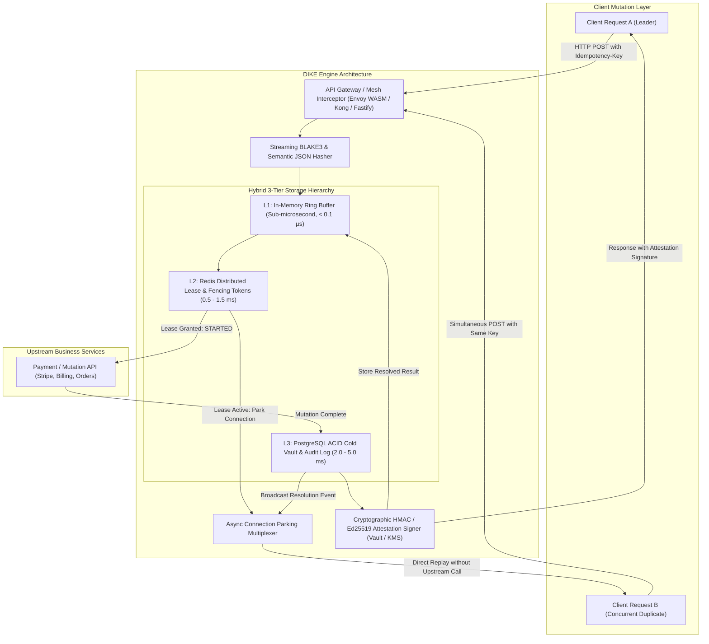
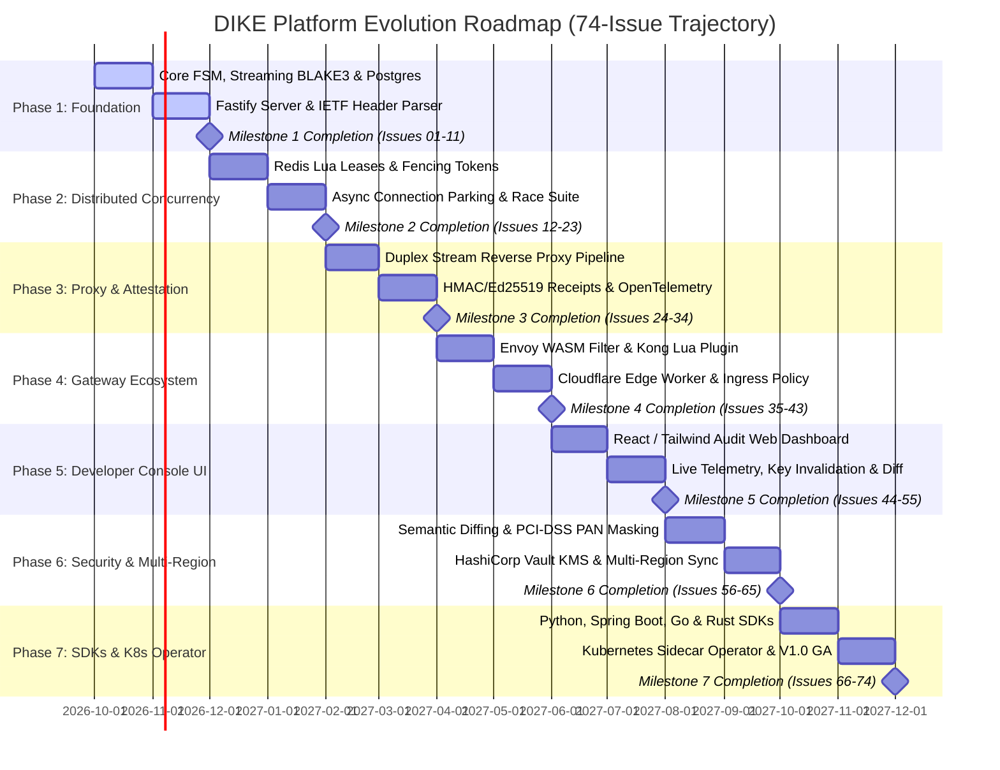

# DIKE: Distributed Idempotency Key Engine

> **DIKE** is an enterprise-grade, high-throughput Distributed Idempotency Key Engine, transparent reverse proxy, and service mesh filter designed to eliminate duplicate transactions, double-charges, and inconsistent mutations across distributed microservice fleets.

---

## 📌 Executive Architecture & Highlights

Most idempotency solutions force an unsustainable trade-off: in-memory Redis solutions lose state during failovers, while relational database table constraints create severe write amplification and connection pool exhaustion under load.

DIKE resolves this through a **Hybrid Three-Tier Storage Pipeline** combined with an **Asynchronous Connection Parking Engine** that eliminates thundering-herd retry storms:

### Key Capabilities
- **Zero-Polling Connection Parking:** Concurrent duplicate requests are held on an async event bus and resolved instantly when the in-flight leader completes, eliminating `409 Conflict` thundering-herd loops.
- **Streaming Incremental Hashing (BLAKE3 / SHA-256):** Computes cryptographic payload fingerprints on the fly with strict $O(1)$ memory consumption, preventing Out-Of-Memory crashes on multi-megabyte payloads.
- **Semantic Payload Hashing & Dynamic Ignore Paths:** Strips benign nonces, timestamps, and client UUIDs to prevent false-positive `422 Payload Mismatch` errors.
- **Three-Tier Storage Hierarchy:** Combines lock-free in-memory lookups (L1), distributed lease coordination with monotonic fencing tokens (L2), and PostgreSQL ACID durability (L3).
- **Service Mesh & Gateway Native Filters:** Native Envoy WebAssembly (WASM) filter (Rust), Kong Gateway plugin (Lua), and Cloudflare Edge Worker support.
- **Cryptographic Attestation Receipts:** Signs replayed responses with HMAC-SHA256 / Ed25519 backed by HashiCorp Vault or AWS KMS to prove response provenance for financial audits.
- **Developer Management Web Console:** Interactive React/Tailwind visual dashboard featuring live key inspection, visual payload diffing, and real-time unparking telemetry.

---

## 📚 Platform Engineering Documentation

The technical foundation is detailed across dedicated specifications in `/docs`:

1. **[Architectural Design & Technical Rationale](docs/ARCHITECTURE.md):** Deep-dive into tiered storage, connection parking, streaming hashing, WASM filters, semantic JSON diffing, and tech stack trade-offs.
2. **[Domain Data Model & Storage Schema](docs/DATA_MODEL.md):** PostgreSQL DDL, GiST/B-tree indexing, Redis key-value lease protocols, and L1 memory buffer topologies.
3. **[STRIDE Threat Model & Security Posture](docs/THREAT_MODEL.md):** Comprehensive vulnerability analysis, payload poisoning defenses, and lease hijacking mitigations.
4. **[Engineering Roadmap & Milestones (74 Issues)](docs/ROADMAP.md):** 74-issue evolutionary trajectory across 7 phases, Gantt schedules, and Trunk-based Git branching strategy.
5. **[Phase-Bifurcated Issue Specifications](docs/.issues/):**
   - [Phase 1: Foundation & Core Engine (`#01` to `#11`)](docs/.issues/01-phase-1-foundation-and-core-engine.md)
   - [Phase 2: Concurrency & Connection Parking (`#12` to `#23`)](docs/.issues/02-phase-2-concurrency-and-parking.md)
   - [Phase 3: Proxy & Attestation Receipts (`#24` to `#34`)](docs/.issues/03-phase-3-proxy-and-attestation.md)
   - [Phase 4: Gateway Ecosystem & Native Plugins (`#35` to `#43`)](docs/.issues/04-phase-4-gateway-ecosystem-and-plugins.md)
   - [Phase 5: Developer Console & Audit UI (`#44` to `#55`)](docs/.issues/05-phase-5-developer-console-and-audit-ui.md)
   - [Phase 6: Advanced Security & Multi-Region (`#56` to `#65`)](docs/.issues/06-phase-6-advanced-security-and-multi-region.md)
   - [Phase 7: Polyglot SDKs & K8s Operator (`#66` to `#74`)](docs/.issues/07-phase-7-polyglot-sdks-and-k8s-operator.md)
6. **[Issue Label Taxonomy & Governance](docs/.issues/labels.md):** Multidimensional label schema with hex colors and definitions.

---

## 🚀 Engineering Roadmap Overview (74 Issues across 7 Phases)

---

## 🛠️ Technology Stack & Selection Rationale

| Layer | Technology | Primary Rationale |
| :--- | :--- | :--- |
| **Control Plane Runtime** | Node.js 24 LTS & TypeScript 5+ | High I/O event-loop concurrency, native streaming pipelines, type safety |
| **HTTP Framework** | Fastify v5 | High-throughput JSON routing, schema compilation via TypeBox |
| **Service Mesh / WASM** | Rust (`proxy-wasm`) | Zero-cost abstractions, compiles directly to Envoy WebAssembly bytecode |
| **Durability Store** | PostgreSQL 16+ | ACID transactions, row-level locks, jsonb storage for responses |
| **Coordination Store** | Redis 7+ / Dragonfly | Microsecond lease acquisition, Pub/Sub for connection unparking |
| **Hashing Engine** | BLAKE3 / Streaming SHA-256 | High-speed cryptographic digest calculation with $O(1)$ memory usage |
| **Developer Console** | React 19 + Tailwind CSS + Vite | Modular web dashboard for live transaction inspection and telemetry |
| **Test & Benchmarking** | Vitest + k6 + Toxiproxy | Concurrency verification, 1,000+ RPS stress tests, network partition simulation |

---

## ⚖️ License & Governance

DIKE is published under the **Apache 2.0 License**. See [LICENSE](LICENSE) for details.
