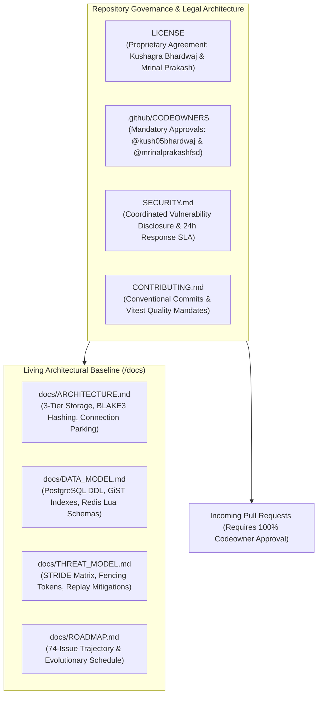
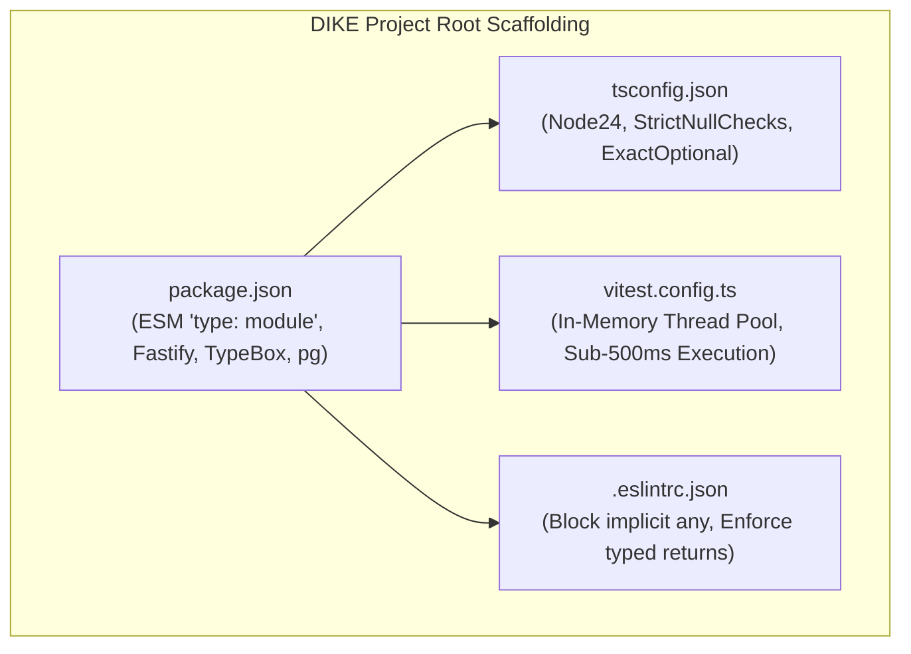
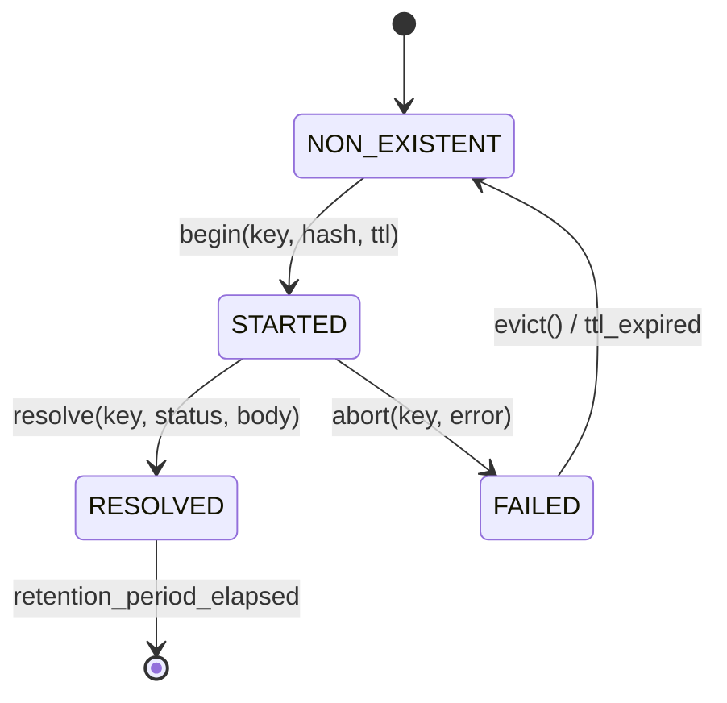
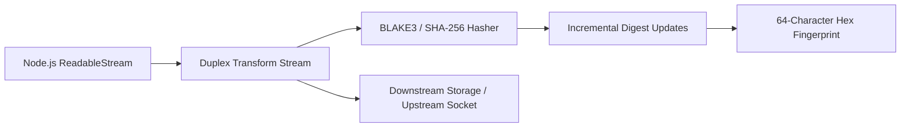
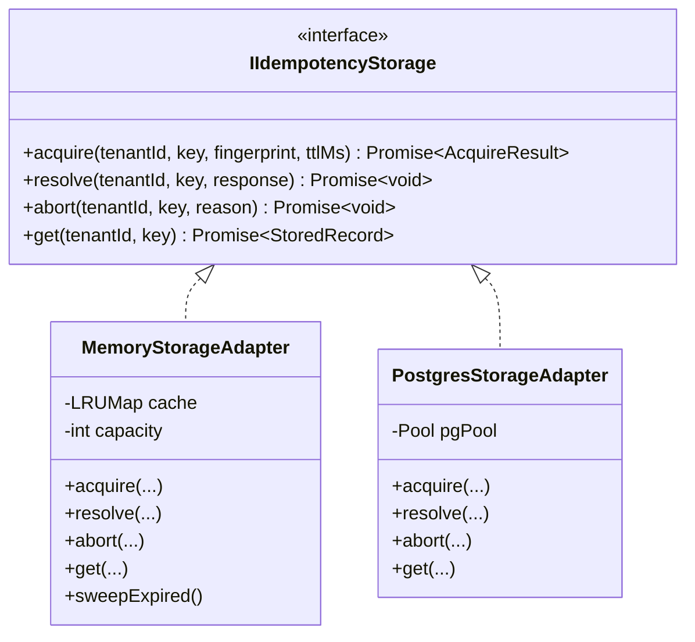
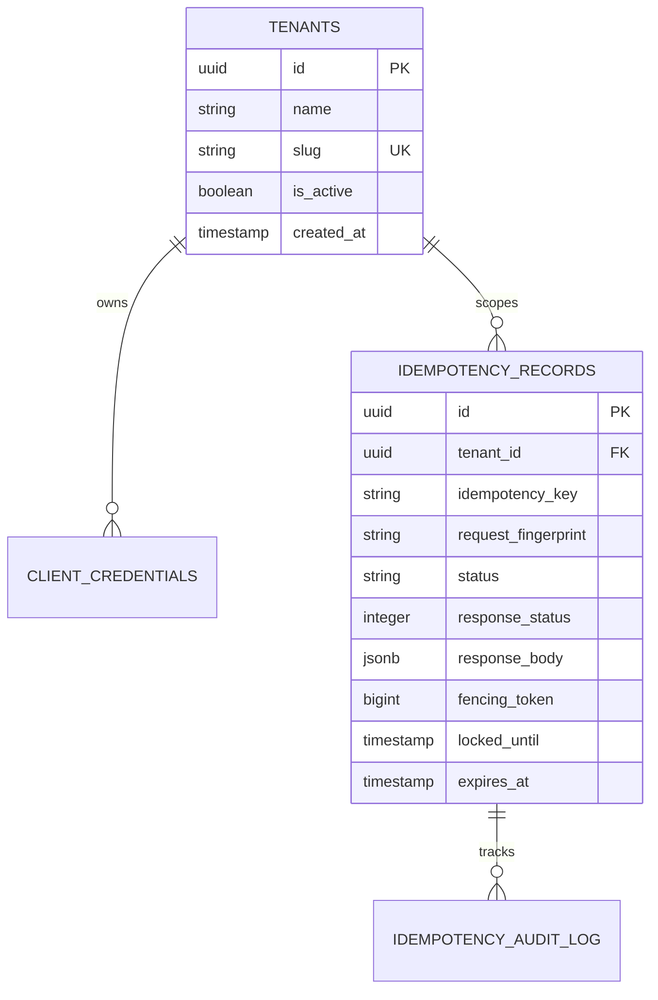
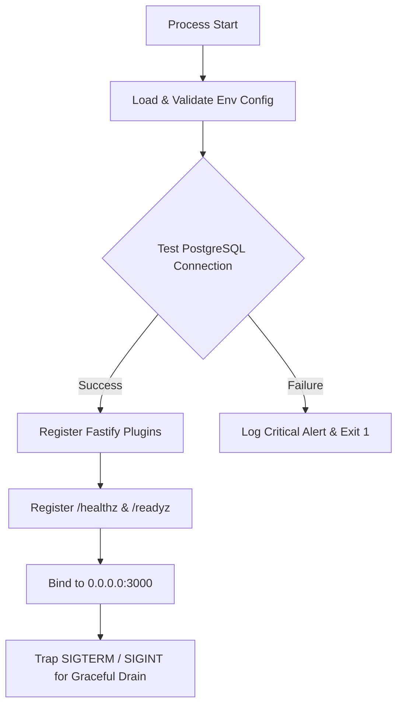
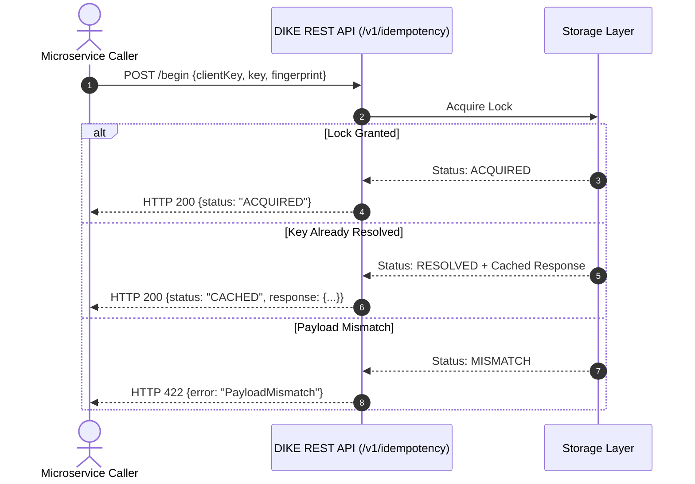
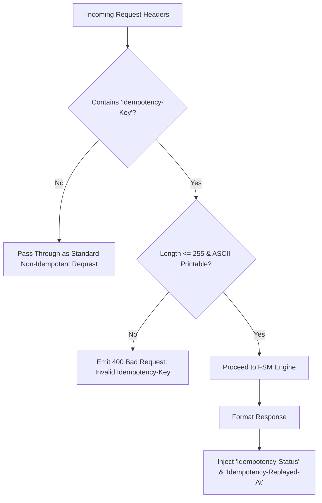
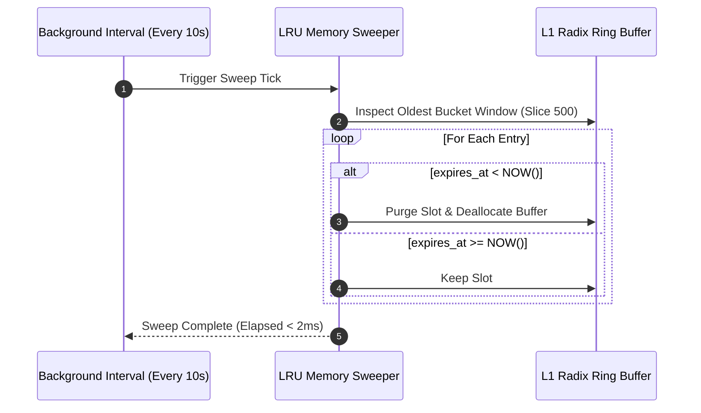

# Phase 1: Foundation & Core Engine

This document details all Phase 1 implementation issues for the Distributed Idempotency Key Engine (DIKE), establishing runtime scaffolding, the core finite state machine, streaming hashing, PostgreSQL storage, Fastify server architecture, and automated quality gates.

---
title: "Foundational Repository Governance, Proprietary Licensing, and Architecture Documentation Baseline"
labels: ["phase:phase-1", "type:chore", "priority:P0-critical", "component:tooling"]
milestone: "M1: Foundation & Core Engine"
---

## Foundational Repository Governance, Proprietary Licensing, and Architecture Documentation Baseline

### Target Files
- [`LICENSE`](file:///c:/Users/USER/Desktop/Extras/pending-projects/DIKE/LICENSE)
- [`.github/CODEOWNERS`](file:///c:/Users/USER/Desktop/Extras/pending-projects/DIKE/.github/CODEOWNERS)
- [`SECURITY.md`](file:///c:/Users/USER/Desktop/Extras/pending-projects/DIKE/SECURITY.md)
- [`CONTRIBUTING.md`](file:///c:/Users/USER/Desktop/Extras/pending-projects/DIKE/CONTRIBUTING.md)
- [`.env.example`](file:///c:/Users/USER/Desktop/Extras/pending-projects/DIKE/.env.example)
- [`.gitignore`](file:///c:/Users/USER/Desktop/Extras/pending-projects/DIKE/.gitignore)
- [`README.md`](file:///c:/Users/USER/Desktop/Extras/pending-projects/DIKE/README.md)
- [`docs/ARCHITECTURE.md`](file:///c:/Users/USER/Desktop/Extras/pending-projects/DIKE/docs/ARCHITECTURE.md)
- [`docs/DATA_MODEL.md`](file:///c:/Users/USER/Desktop/Extras/pending-projects/DIKE/docs/DATA_MODEL.md)
- [`docs/THREAT_MODEL.md`](file:///c:/Users/USER/Desktop/Extras/pending-projects/DIKE/docs/THREAT_MODEL.md)
- [`docs/ROADMAP.md`](file:///c:/Users/USER/Desktop/Extras/pending-projects/DIKE/docs/ROADMAP.md)

### 1. Problem Statement
High-throughput distributed systems infrastructure engines cannot scale reliably or maintain legal and operational integrity without an unambiguous governance foundation, strict security vulnerability disclosure protocols, automated Codeowner approval gates, and a comprehensive mathematical architecture baseline. Without explicit proprietary licensing, intellectual property ownership is ambiguous; without formal security policies, discovered vulnerabilities risk public zero-day disclosure; and without a structured architectural reference, implementation details drift from deterministic distributed systems principles.

### 2. Governance & Security Boundary Diagram


### 3. Implementation & Governance Specification
- **Proprietary License Agreement**: Enact a strict proprietary license retaining all intellectual property, commercial distribution, and derivation rights exclusively to the named Codeowners: **Kushagra Bhardwaj** (`@kush05bhardwaj`) and **Mrinal Prakash** (`@mrinalprakashfsd`).
- **PR Codeownership Automation**: Establish `.github/CODEOWNERS` assigning global wildcard matching (`*`) to both Codeowners, ensuring zero code merges without authorized review.
- **Coordinated Vulnerability Protocol**: Publish `SECURITY.md` defining private vulnerability reporting workflows through GitHub Security Advisories, specifying a 24-hour initial SLA and 7-day remediation timeline.
- **Engineering Standards**: Publish `CONTRIBUTING.md` enforcing Conventional Commits (`feat:`, `fix:`, `docs:`, `chore:`, etc.), trunk-based Gitflow branching, and mandatory Vitest coverage.
- **Living Architectural Suite**: Maintain comprehensive system documentation covering multi-tier storage latency targets, GiST index optimization, streaming hash pipelines, and STRIDE threat mitigation matrices.

### 4. Acceptance Criteria
- [x] Proprietary `LICENSE` explicitly lists Codeowners `@kush05bhardwaj` and `@mrinalprakashfsd`.
- [x] `.github/CODEOWNERS` assigns all root patterns (`*`) to both Codeowners.
- [x] `SECURITY.md` establishes coordinated disclosure SLAs and security advisory routing.
- [x] `CONTRIBUTING.md` enforces Conventional Commits (`feat:`, `fix:`, `docs:`, etc.) and PR standards.
- [x] Living architecture specifications (`ARCHITECTURE.md`, `DATA_MODEL.md`, `THREAT_MODEL.md`, `ROADMAP.md`) published under `/docs`.

---
title: "Project Scaffolding, TypeScript 5 Configuration, and Strict Quality Tooling"
labels: ["phase:phase-1", "type:chore", "priority:P0-critical", "component:tooling"]
milestone: "M1: Foundation & Core Engine"
---

## Project Scaffolding, TypeScript 5 Configuration, and Strict Quality Tooling

### Target Files
- [`package.json`](file:///c:/Users/USER/Desktop/Extras/pending-projects/DIKE/package.json)
- [`tsconfig.json`](file:///c:/Users/USER/Desktop/Extras/pending-projects/DIKE/tsconfig.json)
- [`vitest.config.ts`](file:///c:/Users/USER/Desktop/Extras/pending-projects/DIKE/vitest.config.ts)
- [`.eslintrc.json`](file:///c:/Users/USER/Desktop/Extras/pending-projects/DIKE/.eslintrc.json)

### 1. Problem Statement
DIKE requires a modern, high-performance TypeScript runtime environment with zero overhead, strict type checking, and sub-second test execution. Without strict compiler flags (`exactOptionalPropertyTypes`, `noUncheckedIndexedAccess`), subtle distributed state bugs can evade compile-time detection.

### 2. Structural Component Diagram


### 3. Technical Specification
- Initialize `package.json` with ESM configuration (`"type": "module"`).
- Configure `tsconfig.json` targeting Node.js 24 LTS with `exactOptionalPropertyTypes`, `strictNullChecks`, and `noUncheckedIndexedAccess`.
- Set up Vitest with in-memory execution hooks and concurrency flags.
- Establish scripts for `dev`, `build`, `test`, `lint`, and `migrate`.

### 4. Acceptance Criteria
- [ ] `npm run build` compiles clean TypeScript into `/dist` without errors.
- [ ] `npm test` executes Vitest suite in under 500ms.
- [ ] Strict ESLint rules block undeclared variables and implicit `any`.

---
title: "Core Idempotency Finite State Machine (FSM) Engine"
labels: ["phase:phase-1", "type:feature", "priority:P0-critical", "component:core/engine"]
milestone: "M1: Foundation & Core Engine"
---

## Core Idempotency Finite State Machine (FSM) Engine

### Target Files
- [`src/core/fsm.ts`](file:///c:/Users/USER/Desktop/Extras/pending-projects/DIKE/src/core/fsm.ts)
- [`src/core/types.ts`](file:///c:/Users/USER/Desktop/Extras/pending-projects/DIKE/src/core/types.ts)

### 1. Problem Statement
A robust idempotency system must govern key state transitions with deterministic mathematical correctness, preventing illegal state transitions (e.g., attempting to resolve a key that was never started or re-executing an already resolved transaction).

### 2. Process State Diagram


### 3. Technical Specification
- Define state union: `'NON_EXISTENT' | 'STARTED' | 'RESOLVED' | 'FAILED'`.
- Implement `IdempotencyFSM` class enforcing legal transitions:
  - `transitionToStarted(key, fingerprint, ttlMs)`
  - `transitionToResolved(key, responsePayload)`
  - `transitionToFailed(key, errorReason)`
- Return typed transition results including previous state, new state, and error envelopes.

### 4. Acceptance Criteria
- [ ] Rejects duplicate `begin()` on already resolved keys.
- [ ] Throws deterministic `IllegalStateTransitionError` on invalid transitions.
- [ ] 100% unit test branch coverage for all state edges.

---
title: "Streaming Incremental Request Hasher (BLAKE3 & Streaming SHA-256)"
labels: ["phase:phase-1", "type:feature", "priority:P0-critical", "component:core/hasher"]
milestone: "M1: Foundation & Core Engine"
---

## Streaming Incremental Request Hasher (BLAKE3 & Streaming SHA-256)

### Target Files
- [`src/core/hasher.ts`](file:///c:/Users/USER/Desktop/Extras/pending-projects/DIKE/src/core/hasher.ts)

### 1. Problem Statement
Buffering multi-megabyte request bodies into memory to calculate payload fingerprints causes Out-Of-Memory (OOM) failures under burst traffic. Fingerprinting must operate over continuous streams in $O(1)$ memory.

### 2. Data Flow Diagram


### 3. Technical Specification
- Create `createStreamingHasher(algorithm = 'blake3' | 'sha256')`.
- Process Node.js `Readable` streams with chunk-by-chunk digest updates.
- Incorporate HTTP Method, Canonical URI Path, and Request Body into the final digest:
  $$\text{Fingerprint} = \text{Hash}\left(\text{METHOD} \parallel \text{PATH} \parallel \text{BODY\_STREAM}\right)$$
- Ensure $O(1)$ constant memory utilization regardless of payload size.

### 4. Acceptance Criteria
- [ ] Verified constant memory footprint (< 5MB RAM) when hashing a 100MB synthetic stream.
- [ ] Produces deterministic hex output matching standard command-line tools.
- [ ] Benchmarks exceed 500 MB/s hashing throughput.

---
title: "Abstract Storage Adapter Interface & L1 In-Memory Ring Buffer"
labels: ["phase:phase-1", "type:architecture", "priority:P1-high", "component:storage"]
milestone: "M1: Foundation & Core Engine"
---

## Abstract Storage Adapter Interface & L1 In-Memory Ring Buffer

### Target Files
- [`src/storage/interface.ts`](file:///c:/Users/USER/Desktop/Extras/pending-projects/DIKE/src/storage/interface.ts)
- [`src/storage/memory.ts`](file:///c:/Users/USER/Desktop/Extras/pending-projects/DIKE/src/storage/memory.ts)

### 1. Problem Statement
Storage implementations (Memory, Redis, PostgreSQL) must satisfy a uniform contract so layers can be swapped or tiered seamlessly. The L1 in-memory ring buffer must provide sub-microsecond cache hit resolution for rapid repeat requests.

### 2. Class Diagram


### 3. Technical Specification
- Define `IIdempotencyStorage` interface with typed return structures.
- Implement `MemoryStorageAdapter` utilizing an LRU map with 50,000 slots and an active sweep timer.
- Provide atomic key lookup and insertion with $< 0.1\mu s$ execution latency.

### 4. Acceptance Criteria
- [ ] Memory adapter handles 100,000 sequential `acquire()` and `resolve()` calls in < 150ms.
- [ ] Automatically purges expired keys when sliding TTL elapses.

---
title: "PostgreSQL Relational Persistence & Migration System"
labels: ["phase:phase-1", "type:feature", "priority:P0-critical", "component:storage/postgres"]
milestone: "M1: Foundation & Core Engine"
---

## PostgreSQL Relational Persistence & Migration System

### Target Files
- [`src/storage/postgres.ts`](file:///c:/Users/USER/Desktop/Extras/pending-projects/DIKE/src/storage/postgres.ts)
- [`src/db/migrations/001_initial_schema.sql`](file:///c:/Users/USER/Desktop/Extras/pending-projects/DIKE/src/db/migrations/001_initial_schema.sql)

### 1. Problem Statement
Completed mutations require ACID persistence so that cache hits survive application restarts and container failovers. Concurrent attempts to insert the same key must be resolved deterministically without database deadlocks.

### 2. Entity-Relationship Diagram (ERD)


### 3. Technical Specification
- Write SQL migration establishing `tenants`, `client_credentials`, and `idempotency_records`.
- Implement `PostgresStorageAdapter` using connection pooling via `pg`.
- Use parameterized queries and row-level locking (`SELECT ... FOR UPDATE`) during atomic state transitions.
- Add composite index on `(tenant_id, client_key, idempotency_key)`.

### 4. Acceptance Criteria
- [ ] Migration applies cleanly on fresh PostgreSQL 16 instance.
- [ ] Survives concurrent writes with zero deadlock errors under test runner.
- [ ] Supports JSONB serialization and deserialization of response headers and payloads.

---
title: "Fastify Server Architecture & Plugin Pipeline Setup"
labels: ["phase:phase-1", "type:feature", "priority:P0-critical", "component:server"]
milestone: "M1: Foundation & Core Engine"
---

## Fastify Server Architecture & Plugin Pipeline Setup

### Target Files
- [`src/server/app.ts`](file:///c:/Users/USER/Desktop/Extras/pending-projects/DIKE/src/server/app.ts)
- [`src/server/server.ts`](file:///c:/Users/USER/Desktop/Extras/pending-projects/DIKE/src/server/server.ts)
- [`src/server/config.ts`](file:///c:/Users/USER/Desktop/Extras/pending-projects/DIKE/src/server/config.ts)

### 1. Problem Statement
The platform needs an HTTP server engine capable of high-throughput routing with sub-millisecond response latency and health probes that can interface with container orchestrators.

### 2. Component Lifecycle Diagram


### 3. Technical Specification
- Scaffold Fastify v5 application with structured error handlers.
- Implement configuration loader with strict environment variable validation via TypeBox.
- Add standard health-check routes: `/healthz` (liveness) and `/readyz` (database connectivity).
- Configure graceful shutdown hooks on `SIGTERM` and `SIGINT`.

### 4. Acceptance Criteria
- [ ] Server initializes and responds to `/healthz` with HTTP 200 within 200ms of startup.
- [ ] `/readyz` returns 503 if PostgreSQL pool is unavailable.
- [ ] Closes all active connections gracefully without dropping in-flight requests.

---
title: "Direct Idempotency Management REST API Routes"
labels: ["phase:phase-1", "type:feature", "priority:P1-high", "component:server/routes"]
milestone: "M1: Foundation & Core Engine"
---

## Direct Idempotency Management REST API Routes

### Target Files
- [`src/server/routes/idempotency.ts`](file:///c:/Users/USER/Desktop/Extras/pending-projects/DIKE/src/server/routes/idempotency.ts)

### 1. Problem Statement
Applications operating in microservice environments require programmatic HTTP endpoints to acquire, resolve, and release idempotency locks without passing through a proxy layer.

### 2. Sequence Diagram


### 3. Technical Specification
- Implement `POST /v1/idempotency/begin`
  - Body: `{ clientKey, idempotencyKey, method, path, payload }`
  - Response: `{ status: 'ACQUIRED' | 'CACHED' | 'MISMATCH', record? }`
- Implement `POST /v1/idempotency/resolve`
  - Body: `{ clientKey, idempotencyKey, statusCode, headers, body }`
- Implement `POST /v1/idempotency/abort`
  - Body: `{ clientKey, idempotencyKey, reason }`

### 4. Acceptance Criteria
- [ ] Full TypeBox request validation rejects malformed payloads with 400 Bad Request.
- [ ] Returns 422 if an existing key is presented with a mismatched body.
- [ ] Returns 200 with stored response if key is already resolved.

---
title: "IETF Idempotency-Key Standard HTTP Header Compliance"
labels: ["phase:phase-1", "type:feature", "priority:P1-high", "component:server/headers"]
milestone: "M1: Foundation & Core Engine"
---

## IETF Idempotency-Key Standard HTTP Header Compliance

### Target Files
- [`src/server/plugins/ietf_headers.ts`](file:///c:/Users/USER/Desktop/Extras/pending-projects/DIKE/src/server/plugins/ietf_headers.ts)

### 1. Problem Statement
Custom or ad-hoc header formats create vendor lock-in. DIKE must adhere to the official IETF draft specification (`draft-ietf-httpapi-idempotency-key-header-05`) for HTTP idempotency.

### 2. Process Flowchart


### 3. Technical Specification
- Parse standard header: `Idempotency-Key: <key-value>`.
- Validate key length and character set (reject keys exceeding 255 chars or containing illegal control characters).
- On resolved response playback, emit:
  - `Idempotency-Status: HIT` (or `MISS` for fresh executions)
  - `Idempotency-Replayed-At: <ISO8601-Timestamp>`

### 4. Acceptance Criteria
- [ ] Conforms to `draft-ietf-httpapi-idempotency-key-header-05`.
- [ ] Emits accurate replay headers on all cached responses.

---
title: "Structured Logging with Zero-Secret Redaction"
labels: ["phase:phase-1", "type:chore", "priority:P2-medium", "component:telemetry"]
milestone: "M1: Foundation & Core Engine"
---

## Structured Logging with Zero-Secret Redaction

### Target Files
- [`src/utils/logger.ts`](file:///c:/Users/USER/Desktop/Extras/pending-projects/DIKE/src/utils/logger.ts)

### 1. Problem Statement
Mutation payloads frequently contain sensitive credit card details, passwords, or personal data. Logs must never expose secrets or raw customer payloads, even during debug-level logging.

### 2. Pipeline Diagram
```mermaid
flowchart LR
    LogEvent[Raw Log Record] --> Scanner[Redaction Regex & Path Scanner]
    Scanner --> Blacklist{Matches Secret Key or Auth Header?}
    Blacklist -->|Yes| Mask[Replace with '[REDACTED]']
    Blacklist -->|No| Keep[Preserve Value]
    Mask --> Formatter[Pino JSON Serializer]
    Keep --> Formatter
    Formatter --> Stdout[Structured JSON Output]
```

### 3. Technical Specification
- Implement Pino logger instance with structured JSON output.
- Configure automatic redaction paths:
  - `req.headers.authorization`
  - `req.headers['x-api-key']`
  - `req.body.password`
  - `req.body.creditCard`
  - `req.body.token`
- Generate unique request trace ID (`x-trace-id`) for distributed log correlation.

### 4. Acceptance Criteria
- [ ] Sensitive headers and fields replaced with `[REDACTED]` in log output.
- [ ] Zero secret leakage verified by automated test assertions.

---
title: "In-Memory TTL Sliding Expiration Sweeper Worker"
labels: ["phase:phase-1", "type:reliability", "priority:P2-medium", "component:storage/memory"]
milestone: "M1: Foundation & Core Engine"
---

## In-Memory TTL Sliding Expiration Sweeper Worker

### Target Files
- [`src/storage/memory_sweeper.ts`](file:///c:/Users/USER/Desktop/Extras/pending-projects/DIKE/src/storage/memory_sweeper.ts)

### 1. Problem Statement
Process-local memory allocations in the L1 ring buffer must be aggressively garbage-collected to prevent memory leaks during long-running server uptime without freezing the Node.js event loop.

### 2. Execution Timeline Diagram


### 3. Technical Specification
- Implement active TTL sweeper thread running every 10 seconds.
- Scan oldest bucket entries in LRU ring buffer; unpin and delete records where `expires_at < NOW()`.
- Bound sweep time to $< 2ms$ per cycle to avoid event loop stalls.

### 4. Acceptance Criteria
- [ ] Keeps process heap usage stable under continuous memory allocation.
- [ ] Zero uncollected expired records remaining after 2 sweep cycles.

---
title: "Vitest Unit Test Suite for State Machine & Hash Collisions"
labels: ["phase:phase-1", "type:test", "priority:P0-critical", "component:testing"]
milestone: "M1: Foundation & Core Engine"
---

## Vitest Unit Test Suite for State Machine & Hash Collisions

### Target Files
- [`tests/unit/fsm.test.ts`](file:///c:/Users/USER/Desktop/Extras/pending-projects/DIKE/tests/unit/fsm.test.ts)
- [`tests/unit/hasher.test.ts`](file:///c:/Users/USER/Desktop/Extras/pending-projects/DIKE/tests/unit/hasher.test.ts)

### 1. Problem Statement
The core state machine and streaming hasher must possess exhaustive test coverage before building distributed concurrency layers on top. Unchecked edge cases can cause silent state corruption.

### 2. Test Suite Flow Diagram
```mermaid
flowchart TD
    Root[Vitest Test Runner] --> FSMSuite[FSM Transition Suite]
    Root --> HasherSuite[Streaming Hasher Suite]
    
    FSMSuite --> T1[Test: Legal State Transitions]
    FSMSuite --> T2[Test: Illegal State Throws Exception]
    FSMSuite --> T3[Test: Double Resolve Prevention]
    
    HasherSuite --> H1[Test: Empty Stream Consistency]
    HasherSuite --> H2[Test: Large 50MB Stream O(1) RAM]
    HasherSuite --> H3[Test: Unicode & JSON Key Normalization]
```

### 3. Technical Specification
- Write test matrix covering all legal and illegal FSM transitions.
- Verify payload mismatch detection across varying payload types (JSON, text, binary buffer).
- Verify hash consistency across empty payloads, large payloads, and Unicode strings.

### 4. Acceptance Criteria
- [ ] Over 95% line and branch coverage across `/src/core`.
- [ ] All tests execute deterministically with zero flakiness.
