# Phase 2: Distributed Concurrency & Connection Parking

This document details all Phase 2 implementation issues for the Distributed Idempotency Key Engine (DIKE), focusing on Redis distributed leases, Lua atomic scripts, monotonic fencing tokens, async connection parking, zero-downtime socket draining, and high-concurrency race testing.

---
title: "Redis Connection Pool with Sentinel & Cluster Auto-Discovery"
labels: ["phase:phase-2", "type:feature", "priority:P0-critical", "component:storage/redis"]
milestone: "M2: Distributed Concurrency & Parking"
---

## Redis Connection Pool with Sentinel & Cluster Auto-Discovery

### Target Files
- [`src/storage/redis.ts`](file:///c:/Users/USER/Desktop/Extras/pending-projects/DIKE/src/storage/redis.ts)
- [`src/storage/redis_pool.ts`](file:///c:/Users/USER/Desktop/Extras/pending-projects/DIKE/src/storage/redis_pool.ts)

### 1. Problem Statement
Multi-instance deployments of DIKE require a high-throughput, low-latency distributed state store to coordinate leases across cluster nodes with support for Sentinel and Redis Cluster failovers without manual intervention.

### 2. Topology Architecture Diagram
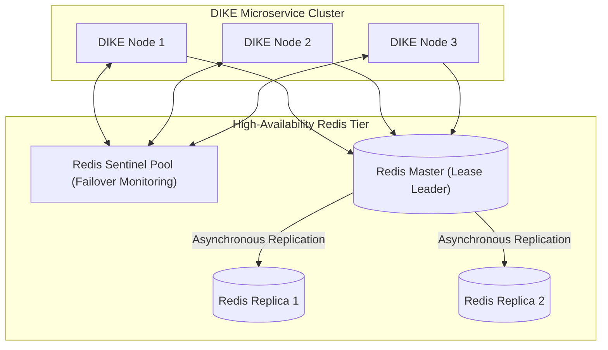

### 3. Technical Specification
- Implement Redis client wrapper using `ioredis` with automated reconnection backoff.
- Implement health checks and connection lifecycle handlers.
- Support standalone Redis, Redis Sentinel, and Redis Cluster configurations via unified connection strings.
- Configure slot hash tags (`{tenant}:{key}`) ensuring related keys map to identical cluster shards.

### 4. Acceptance Criteria
- [ ] Connects cleanly to Redis 7+, Dragonfly, and Redis Cluster instances.
- [ ] Auto-reconnects with exponential jittered backoff upon temporary network drop.

---
title: "Atomic Lease Acquisition via Custom Redis Lua Script"
labels: ["phase:phase-2", "type:feature", "priority:P0-critical", "component:storage/redis/lua"]
milestone: "M2: Distributed Concurrency & Parking"
---

## Atomic Lease Acquisition via Custom Redis Lua Script

### Target Files
- [`src/storage/lua/acquire_lease.lua`](file:///c:/Users/USER/Desktop/Extras/pending-projects/DIKE/src/storage/lua/acquire_lease.lua)

### 1. Problem Statement
Checking if a key is resolved, verifying the payload fingerprint, and creating an execution lease must occur in a single atomic operation to eliminate race conditions between concurrent requests.

### 2. Process Flow Diagram
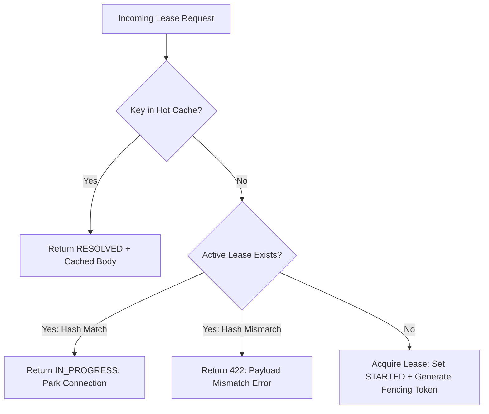

### 3. Technical Specification
- Implement Lua script executing atomic check-and-set:
  - Verifies cached resolution in `dike:resolved:{tenant}:{key}`.
  - Inspects active lease in `dike:lease:{tenant}:{key}`.
  - Checks payload fingerprint equivalence.
  - Atomically increments global counter `dike:fence:counter` and binds lease with millisecond TTL.

### 4. Acceptance Criteria
- [ ] Zero race conditions when 100 simultaneous threads execute `acquire_lease.lua`.
- [ ] Returns exact state classification (`ACQUIRED`, `IN_PROGRESS`, `RESOLVED`, `MISMATCH`) in a single Redis roundtrip.

---
title: "Monotonically Increasing Fencing Tokens & Zombie Writer Defenses"
labels: ["phase:phase-2", "type:security", "priority:P0-critical", "component:core/fencing"]
milestone: "M2: Distributed Concurrency & Parking"
---

## Monotonically Increasing Fencing Tokens & Zombie Writer Defenses

### Target Files
- [`src/core/fencing.ts`](file:///c:/Users/USER/Desktop/Extras/pending-projects/DIKE/src/core/fencing.ts)
- [`src/storage/postgres.ts`](file:///c:/Users/USER/Desktop/Extras/pending-projects/DIKE/src/storage/postgres.ts)

### 1. Problem Statement
If a worker holding a lease suffers a long garbage-collection pause or network partition, its lease expires, and another worker takes over. When the paused worker wakes up, it must be blocked from overwriting state.

### 2. Sequence Diagram
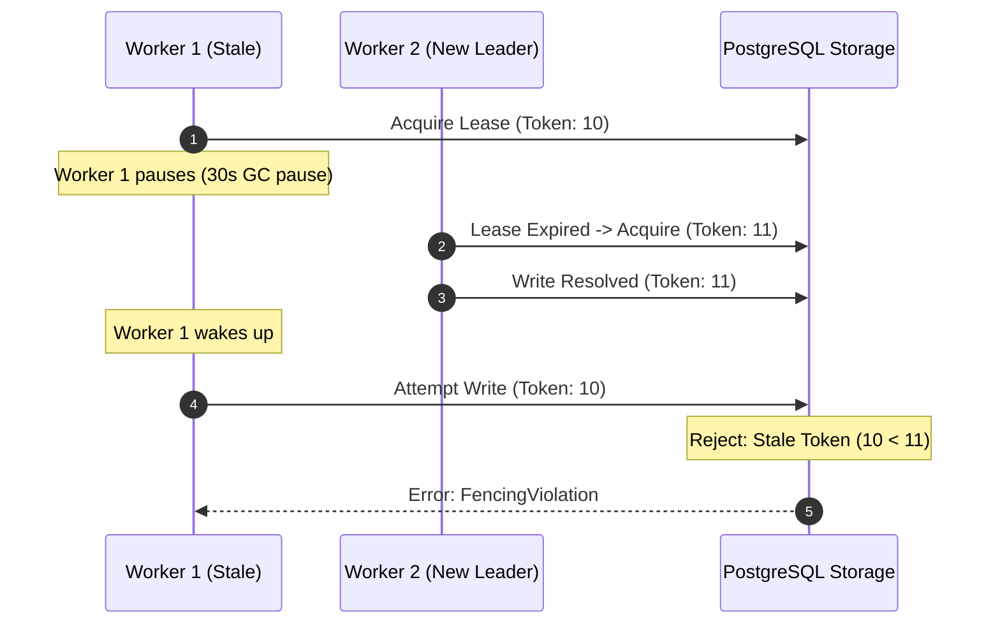

### 3. Technical Specification
- Include 64-bit integer `fencing_token` in every lease.
- Enforce condition on all PostgreSQL update statements:
  `WHERE tenant_id = $1 AND idempotency_key = $2 AND fencing_token <= $3`.
- Stale writes trigger an explicit `StaleFencingTokenError` and discard the stale response.

### 4. Acceptance Criteria
- [ ] Test verifying that delayed worker writes with lower fencing tokens are rejected.
- [ ] Fencing tokens increment monotonically across the cluster.

---
title: "Asynchronous Connection Parking Engine (EventBus Multiplexer)"
labels: ["phase:phase-2", "type:feature", "priority:P0-critical", "component:core/parking"]
milestone: "M2: Distributed Concurrency & Parking"
---

## Asynchronous Connection Parking Engine (EventBus Multiplexer)

### Target Files
- [`src/core/parking.ts`](file:///c:/Users/USER/Desktop/Extras/pending-projects/DIKE/src/core/parking.ts)

### 1. Problem Statement
Returning `409 Conflict` on concurrent requests forces client retry storms. DIKE must park secondary connections in memory and resolve them when the leader finishes.

### 2. Connection Parking Lifecycle Diagram
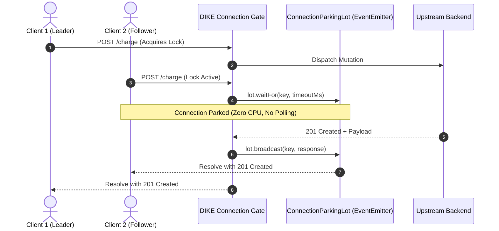

### 3. Technical Specification
- Implement `ConnectionParkingLot` class backed by Node.js `EventEmitter`.
- When a request receives `IN_PROGRESS` from the lease coordinator:
  - Park the request by attaching a one-time promise listener: `lot.waitFor(key, timeoutMs)`.
  - Hold the HTTP socket open without polling.
- When the leader finishes, invoke `lot.broadcast(key, response)`.
- All parked sockets resolve immediately with the cached result.

### 4. Acceptance Criteria
- [ ] 50 concurrent requests for the same key complete in a single execution lifecycle.
- [ ] Upstream service is invoked exactly once.

---
title: "Cross-Node Resolution Broadcasting via Redis Pub/Sub"
labels: ["phase:phase-2", "type:feature", "priority:P1-high", "component:storage/pubsub"]
milestone: "M2: Distributed Concurrency & Parking"
---

## Cross-Node Resolution Broadcasting via Redis Pub/Sub

### Target Files
- [`src/storage/pubsub.ts`](file:///c:/Users/USER/Desktop/Extras/pending-projects/DIKE/src/storage/pubsub.ts)

### 1. Problem Statement
In a multi-node cluster, Request A (Leader) may hit Node 1, while Request B (Parked) hits Node 2. Node 2 must be notified when Node 1 completes.

### 2. Architecture Diagram
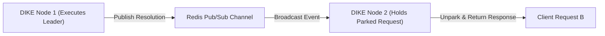

### 3. Technical Specification
- Configure Redis subscriber connection listening to `dike:events:*`.
- When a node resolves a key, publish a compact JSON payload to `dike:events:{tenant}:{key}`.
- Node 2 intercepts the event, unparks local sockets listening on that key, and forwards the response.

### 4. Acceptance Criteria
- [ ] Multi-instance integration test confirms cross-node unparking in under 2ms.
- [ ] Memory listeners cleanly disposed after message delivery to prevent memory leaks.

---
title: "Dynamic Lease Renewal & Deadman Heartbeat Timers"
labels: ["phase:phase-2", "type:feature", "priority:P1-high", "component:core/lease"]
milestone: "M2: Distributed Concurrency & Parking"
---

## Dynamic Lease Renewal & Deadman Heartbeat Timers

### Target Files
- [`src/core/lease_heartbeat.ts`](file:///c:/Users/USER/Desktop/Extras/pending-projects/DIKE/src/core/lease_heartbeat.ts)

### 1. Problem Statement
Long-running mutations (e.g., complex bank transfers taking 15 seconds) must not have their lease expire prematurely, while crashed workers must release locks promptly.

### 2. Heartbeat Sequence Diagram
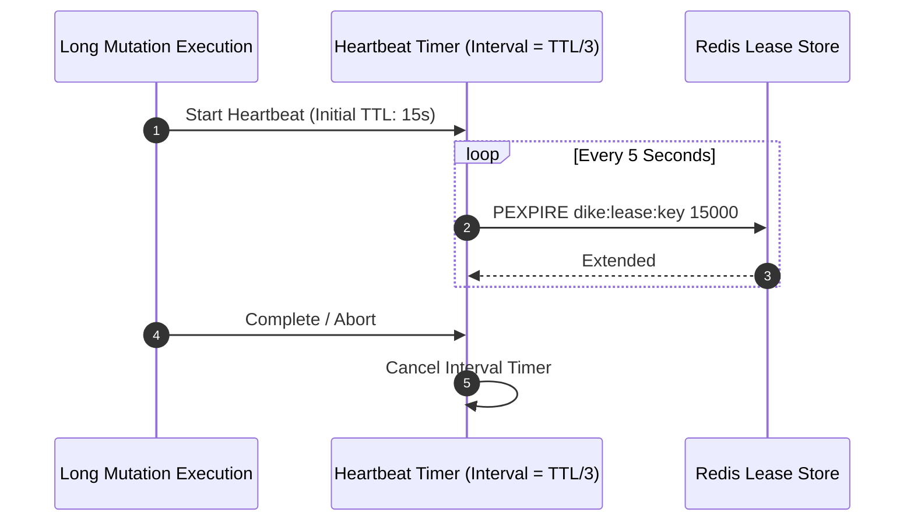

### 3. Technical Specification
- Implement background lease heartbeat timer.
- Every $N/3$ seconds of lease duration, execute `PEXPIRE` refresh if the worker process is healthy.
- Cap maximum lease extension to an absolute hard ceiling (e.g., 60 seconds).
- If process terminates unexpectedly, lease expires naturally via Redis TTL.

### 4. Acceptance Criteria
- [ ] Extends active lease for tasks running longer than initial TTL.
- [ ] Respects hard ceiling to prevent indefinite lock retention.

---
title: "Bounded Client Parking Timeout Handlers"
labels: ["phase:phase-2", "type:reliability", "priority:P1-high", "component:core/parking"]
milestone: "M2: Distributed Concurrency & Parking"
---

## Bounded Client Parking Timeout Handlers

### Target Files
- [`src/core/parking_timeout.ts`](file:///c:/Users/USER/Desktop/Extras/pending-projects/DIKE/src/core/parking_timeout.ts)

### 1. Problem Statement
If the leader request hangs indefinitely or the network disconnects, parked client connections must not remain open forever, causing client-side socket exhaustion.

### 2. Timeout Transition Diagram
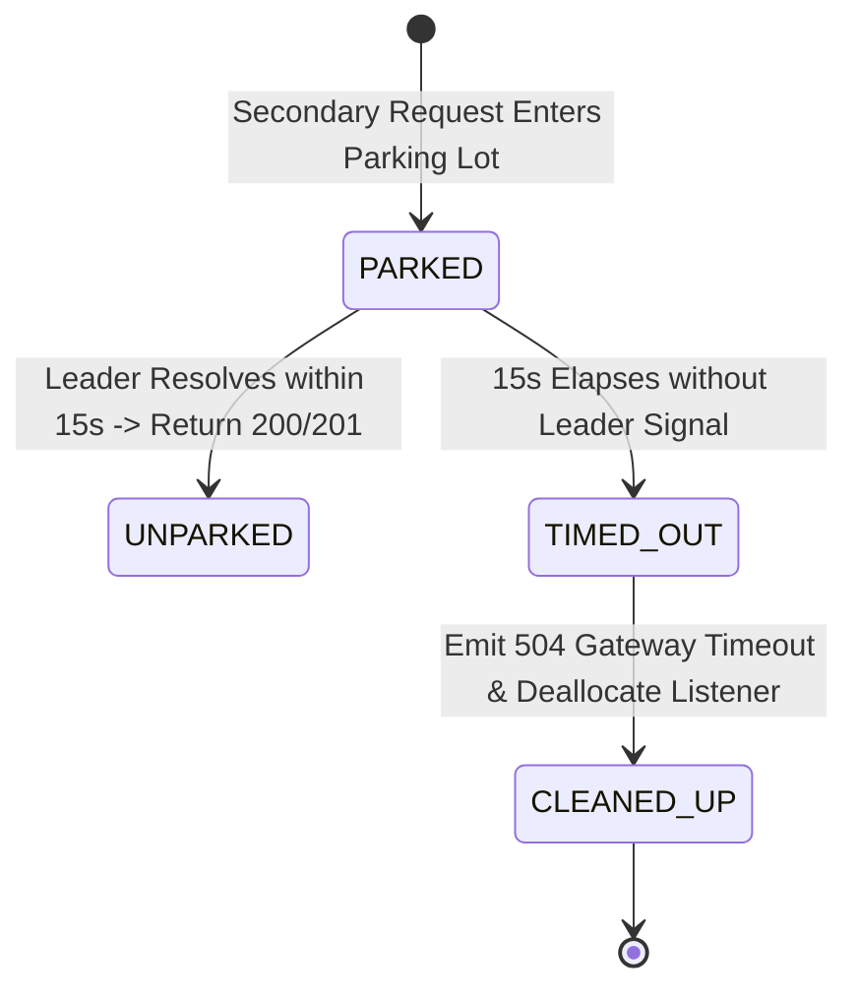

### 3. Technical Specification
- Configure bounded timeout on parked connections (default: 15 seconds).
- If the leader does not complete within the window:
  - Release parked socket with `HTTP 504 Gateway Timeout`.
  - Clean up event listeners to prevent listener leaks.
  - Provide structured error message indicating the upstream operation timed out.

### 4. Acceptance Criteria
- [ ] Unparks hanging connections cleanly after timeout elapses.
- [ ] Node.js `EventEmitter` reports zero memory leak warnings.

---
title: "Adaptive Backpressure Controller for Parked Connections"
labels: ["phase:phase-2", "type:reliability", "priority:P1-high", "component:core/backpressure"]
milestone: "M2: Distributed Concurrency & Parking"
---

## Adaptive Backpressure Controller for Parked Connections

### Target Files
- [`src/core/backpressure.ts`](file:///c:/Users/USER/Desktop/Extras/pending-projects/DIKE/src/core/backpressure.ts)

### 1. Problem Statement
If a single key receives 10,000 parked connections simultaneously during a flash crowd, memory limits can be breached. DIKE must enforce adaptive shedding.

### 2. Backpressure Decision Flow
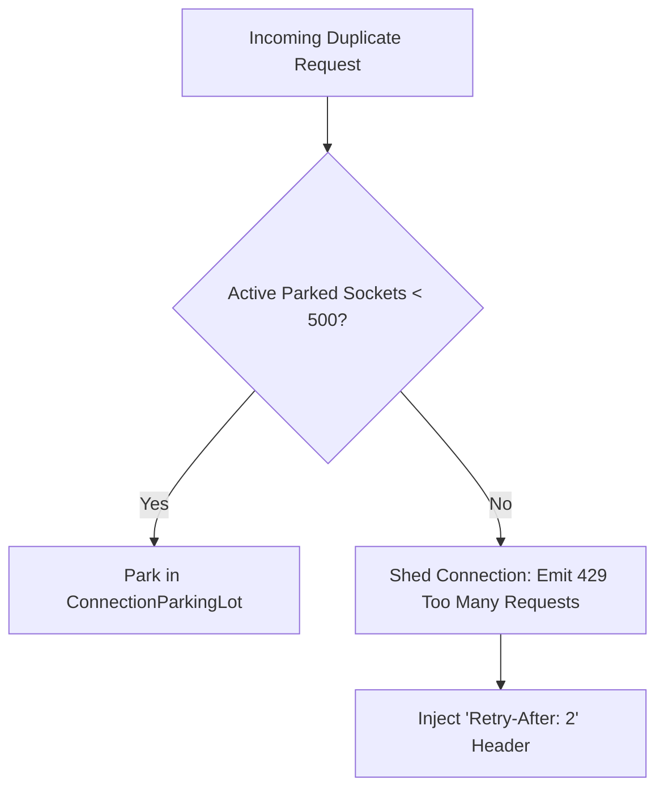

### 3. Technical Specification
- Set hard cap on concurrent parked sockets per key (`MAX_PARKED_PER_KEY = 500`).
- If limit is exceeded, return `429 Too Many Requests` with standard `Retry-After: 2` header to protect memory.

### 4. Acceptance Criteria
- [ ] Safely bounds connection memory consumption during extreme traffic spikes.
- [ ] Sheds excess requests gracefully without crashing server process.

---
title: "Storage Tier Fallback Circuit Breaker"
labels: ["phase:phase-2", "type:reliability", "priority:P1-high", "component:storage/resilience"]
milestone: "M2: Distributed Concurrency & Parking"
---

## Storage Tier Fallback Circuit Breaker

### Target Files
- [`src/storage/fallback.ts`](file:///c:/Users/USER/Desktop/Extras/pending-projects/DIKE/src/storage/fallback.ts)

### 1. Problem Statement
If Redis becomes temporarily unreachable, DIKE should not crash the entire payment pipeline. It must fail safely or degrade to PostgreSQL direct locking.

### 2. Circuit Breaker State Machine
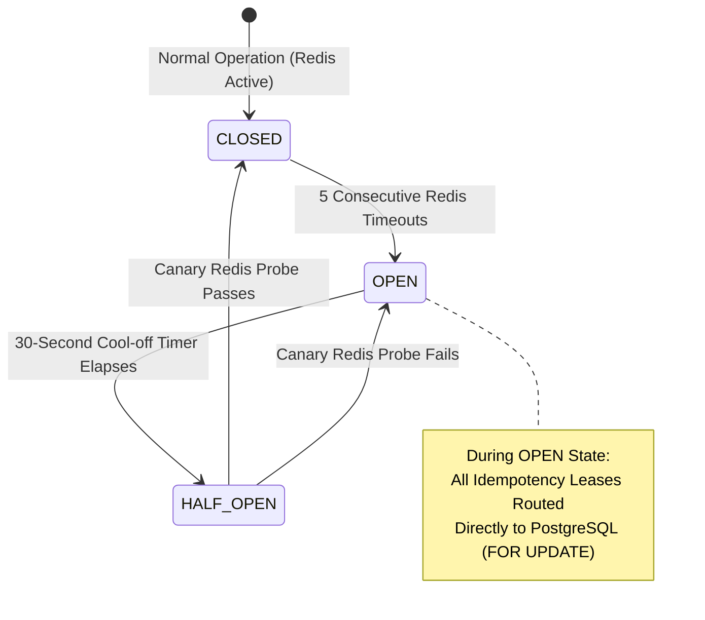

### 3. Technical Specification
- Implement health circuit breaker around Redis L2 operations.
- If Redis fails, automatically degrade to PostgreSQL row-level locks (`SELECT ... FOR UPDATE`).
- Log high-priority alert and restore Redis lease coordination once health checks recover.

### 4. Acceptance Criteria
- [ ] Service continues processing idempotency checks during simulated Redis downtime.
- [ ] Reconnects to Redis seamlessly when connectivity is restored.

---
title: "Rolling Zero-Downtime Socket Drainage (`preStop` Lifecycle Handler)"
labels: ["phase:phase-2", "type:devops", "priority:P1-high", "component:server/drain"]
milestone: "M2: Distributed Concurrency & Parking"
---

## Rolling Zero-Downtime Socket Drainage (`preStop` Lifecycle Handler)

### Target Files
- [`src/server/drain.ts`](file:///c:/Users/USER/Desktop/Extras/pending-projects/DIKE/src/server/drain.ts)

### 1. Problem Statement
During Kubernetes rolling updates, terminating pods must not abruptly drop parked client sockets, causing network errors on live client mutations.

### 2. Kubernetes Pod Lifecycle Drainage Flow
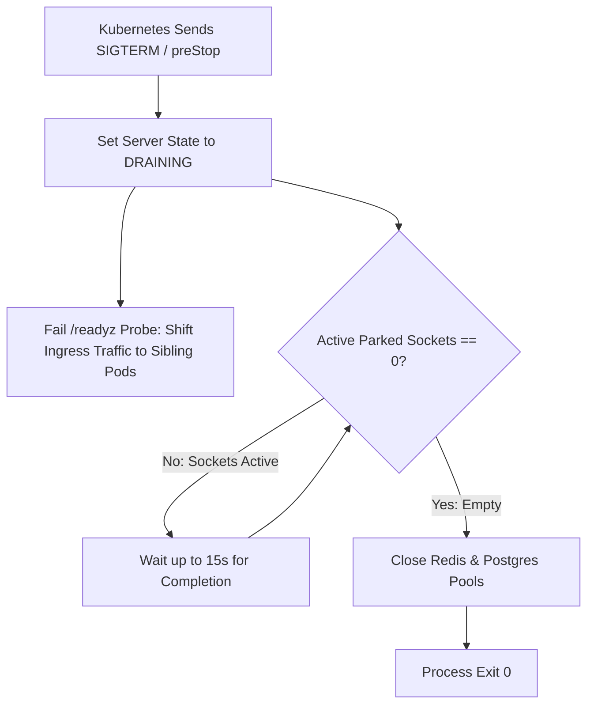

### 3. Technical Specification
- Implement `/drain` endpoint and `SIGTERM` trap.
- Stop accepting new incoming mutation requests (`503` redirecting to sibling pods).
- Hold pod alive for up to 15 seconds allowing active parked connections to resolve.

### 4. Acceptance Criteria
- [ ] Zero dropped connections during Kubernetes rolling pod deployments.
- [ ] Drains remaining sockets smoothly before process exit.

---
title: "Concurrent Race-Condition Test Suite in Vitest"
labels: ["phase:phase-2", "type:test", "priority:P0-critical", "component:testing/concurrency"]
milestone: "M2: Distributed Concurrency & Parking"
---

## Concurrent Race-Condition Test Suite in Vitest

### Target Files
- [`tests/integration/concurrency.test.ts`](file:///c:/Users/USER/Desktop/Extras/pending-projects/DIKE/tests/integration/concurrency.test.ts)

### 1. Problem Statement
Race conditions in distributed systems only appear under heavy, non-deterministic concurrent stress across asynchronous worker threads.

### 2. Concurrency Test Verification Diagram
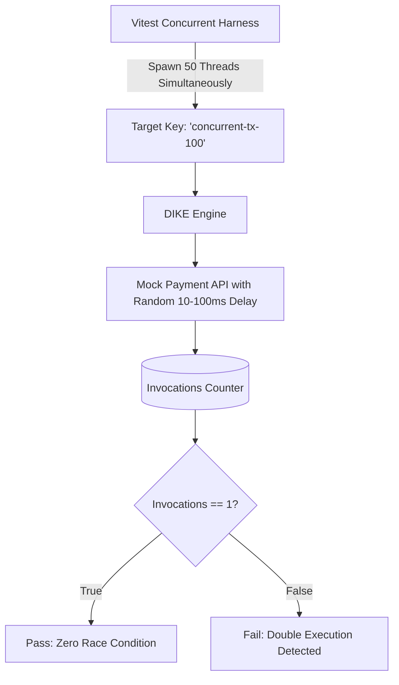

### 3. Technical Specification
- Spawn 50 parallel asynchronous workers targeting the same idempotency key simultaneously.
- Inject random artificial delays (10ms - 100ms) inside mock upstream endpoints.
- Assert that:
  1. Upstream mock is called exactly once.
  2. All 50 callers receive an identical HTTP 200/201 response payload.
  3. Exactly one caller receives `Idempotency-Status: MISS` (Leader).
  4. Exactly 49 callers receive `Idempotency-Status: HIT` (Parked/Cached).

### 4. Acceptance Criteria
- [ ] 100% pass rate over 10 consecutive test runs without race failures.

---
title: "k6 High-Concurrency Stress Benchmark Suite (1,000+ RPS)"
labels: ["phase:phase-2", "type:benchmark", "priority:P1-high", "component:load-tests"]
milestone: "M2: Distributed Concurrency & Parking"
---

## k6 High-Concurrency Stress Benchmark Suite (1,000+ RPS)

### Target Files
- [`load-tests/k6-concurrency.js`](file:///c:/Users/USER/Desktop/Extras/pending-projects/DIKE/load-tests/k6-concurrency.js)

### 1. Problem Statement
Verify that the Fastify server, Redis leases, and connection parking maintain sub-5ms p99 latency under 1,000+ requests per second without memory degradation.

### 2. Load Generation Architecture Diagram
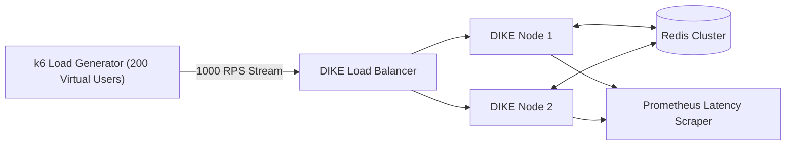

### 3. Technical Specification
- Write k6 scenario simulating 200 virtual users (VUs) sending duplicate requests across 10 shared keys.
- Track metrics: `http_req_duration`, `parked_duration`, `cache_hit_rate`, and `upstream_calls`.
- Assert that `upstream_calls == number_of_unique_keys`.

### 4. Acceptance Criteria
- [ ] Sustains 1,000+ requests per second on standard 4-core machine.
- [ ] p99 latency < 5ms for cached/parked responses.
- [ ] Zero connection drops or uncaught exceptions.
