# Phase 3: Transparent Proxy & Attestation Receipts

This document details all Phase 3 implementation issues for the Distributed Idempotency Key Engine (DIKE), focusing on the transparent reverse proxy architecture, response stream multiplexing, cryptographic attestation receipts, OpenTelemetry observability, and large payload handling.

---
title: "Fastify Transparent Reverse Proxy Plugin Architecture"
labels: ["phase:phase-3", "type:feature", "priority:P0-critical", "component:proxy"]
milestone: "M3: Proxy & Attestation"
---

## Fastify Transparent Reverse Proxy Plugin Architecture

### Target Files
- [`src/proxy/handler.ts`](file:///c:/Users/USER/Desktop/Extras/pending-projects/DIKE/src/proxy/handler.ts)
- [`src/proxy/upstream.ts`](file:///c:/Users/USER/Desktop/Extras/pending-projects/DIKE/src/proxy/upstream.ts)

### 1. Problem Statement
To support zero-code integration with existing backend architectures, DIKE must run as a high-performance reverse proxy that transparently forwards requests to target upstream servers with minimal latency overhead.

### 2. Architecture Diagram
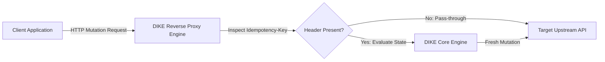

### 3. Technical Specification
- Configure Fastify proxy pipeline routing inbound requests to upstream targets.
- Preserve original client headers, cookies, and HTTP verb.
- Forward real client IP addresses via `X-Forwarded-For` and `X-Forwarded-Proto`.

### 4. Acceptance Criteria
- [ ] Passes transparent traffic through to mock upstream backend with < 0.5ms proxy overhead.
- [ ] Preserves all standard HTTP request and response headers.

---
title: "Selective Idempotency Interception & Pass-Through Pipeline"
labels: ["phase:phase-3", "type:feature", "priority:P0-critical", "component:proxy/interceptor"]
milestone: "M3: Proxy & Attestation"
---

## Selective Idempotency Interception & Pass-Through Pipeline

### Target Files
- [`src/proxy/interceptor.ts`](file:///c:/Users/USER/Desktop/Extras/pending-projects/DIKE/src/proxy/interceptor.ts)

### 1. Problem Statement
Only mutation requests (`POST`, `PUT`, `PATCH`) carrying the `Idempotency-Key` header should trigger locking logic; read requests (`GET`, `HEAD`, `OPTIONS`) must bypass state allocation entirely to avoid unnecessary database and Redis overhead.

### 2. Interception Decision Flow
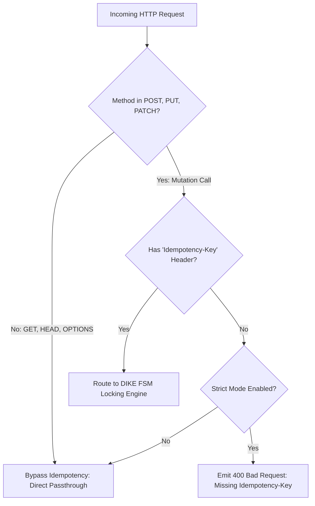

### 3. Technical Specification
- Implement request pre-handler hook.
- Filter by HTTP method: bypass idempotency pipeline for safe/idempotent methods (`GET`, `HEAD`, `OPTIONS`, `DELETE`).
- If `Idempotency-Key` is absent on a `POST` request, pass directly to upstream without state tracking (unless strict enforcement mode is enabled).

### 4. Acceptance Criteria
- [ ] `GET` requests pass through with zero Redis/PostgreSQL queries.
- [ ] Mutation calls without `Idempotency-Key` pass through unhindered when strict mode is disabled.

---
title: "Duplex Response Stream Tee & Ephemeral Result Buffering"
labels: ["phase:phase-3", "type:feature", "priority:P1-high", "component:proxy/stream"]
milestone: "M3: Proxy & Attestation"
---

## Duplex Response Stream Tee & Ephemeral Result Buffering

### Target Files
- [`src/proxy/stream_tee.ts`](file:///c:/Users/USER/Desktop/Extras/pending-projects/DIKE/src/proxy/stream_tee.ts)

### 1. Problem Statement
When the upstream service sends its HTTP response, DIKE must simultaneously stream it back to the client while capturing the payload in memory to store as the resolved idempotent cache.

### 2. Stream Flow Diagram
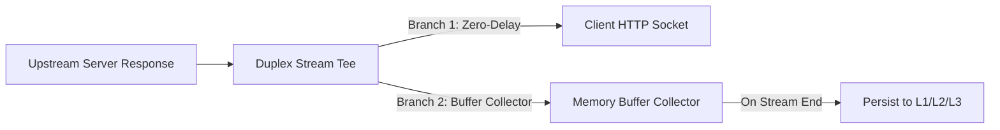

### 3. Technical Specification
- Implement PassThrough duplex stream pipeline.
- Pipe upstream response directly to client socket so time-to-first-byte (TTFB) is unaffected.
- Concurrently buffer up to `MAX_RESPONSE_BYTES` (default: 5MB); abort caching if response exceeds limit.
- On `finish` event, commit status code, headers, and body to the storage tier.

### 4. Acceptance Criteria
- [ ] Zero measurable delay added to client TTFB.
- [ ] Correctly captures and records 200, 201, and 4xx responses.

---
title: "Response Header Whitelist & Hop-by-Hop Filter Engine (RFC 7230)"
labels: ["phase:phase-3", "type:reliability", "priority:P1-high", "component:proxy/headers"]
milestone: "M3: Proxy & Attestation"
---

## Response Header Whitelist & Hop-by-Hop Filter Engine (RFC 7230)

### Target Files
- [`src/proxy/header_filter.ts`](file:///c:/Users/USER/Desktop/Extras/pending-projects/DIKE/src/proxy/header_filter.ts)

### 1. Problem Statement
Certain HTTP headers (e.g. `Connection`, `Keep-Alive`, `Transfer-Encoding`, `Date`) must not be replayed verbatim from cache because they represent ephemeral socket state.

### 2. Header Sanitization Pipeline
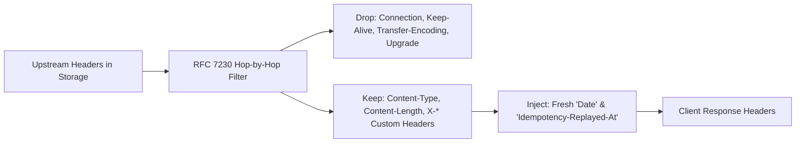

### 3. Technical Specification
- Implement RFC 7230 hop-by-hop header removal filter:
  `Connection`, `Keep-Alive`, `Proxy-Authenticate`, `Proxy-Authorization`, `TE`, `Trailer`, `Transfer-Encoding`, `Upgrade`.
- Preserve content headers (`Content-Type`, `Content-Length`) and custom business headers (`X-*`).
- Inject updated `Date` header reflecting the replay timestamp.

### 4. Acceptance Criteria
- [ ] Strips all hop-by-hop headers from replayed responses.
- [ ] Leaves application-defined business headers intact.

---
title: "Cryptographic HMAC-SHA256 & Ed25519 Attestation Receipt Signer"
labels: ["phase:phase-3", "type:security", "priority:P0-critical", "component:security/attestation"]
milestone: "M3: Proxy & Attestation"
---

## Cryptographic HMAC-SHA256 & Ed25519 Attestation Receipt Signer

### Target Files
- [`src/security/attest.ts`](file:///c:/Users/USER/Desktop/Extras/pending-projects/DIKE/src/security/attest.ts)

### 1. Problem Statement
Auditing systems and financial regulators need mathematical proof that a replayed response is genuine and has not been altered or fabricated by intermediary proxies.

### 2. Cryptographic Signing Pipeline
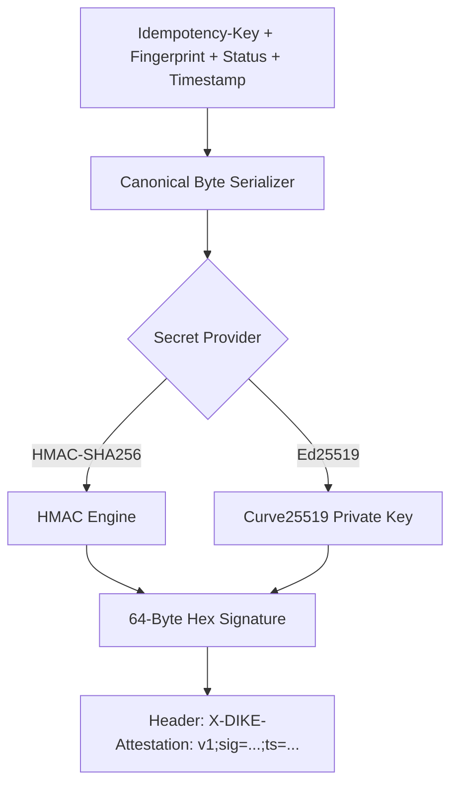

### 3. Technical Specification
- Compute signature over normalized canonical string:
  $$\text{Payload} = \text{tenant\_id} \parallel \text{client\_key} \parallel \text{idempotency\_key} \parallel \text{fingerprint} \parallel \text{status\_code} \parallel \text{timestamp}$$
- Support symmetric HMAC-SHA256 and asymmetric Ed25519 signing keys.
- Emit header: `X-DIKE-Attestation: v1;sig=<hex-signature>;ts=<timestamp>`.

### 4. Acceptance Criteria
- [ ] Generates valid attestation signatures on all replayed cache hits.
- [ ] Constant-time verification prevents side-channel timing attacks.

---
title: "Public Verification Endpoint & Receipt Validator (`POST /v1/attest/verify`)"
labels: ["phase:phase-3", "type:feature", "priority:P2-medium", "component:server/routes"]
milestone: "M3: Proxy & Attestation"
---

## Public Verification Endpoint & Receipt Validator (`POST /v1/attest/verify`)

### Target Files
- [`src/server/routes/attest.ts`](file:///c:/Users/USER/Desktop/Extras/pending-projects/DIKE/src/server/routes/attest.ts)

### 1. Problem Statement
Third-party auditors need a standalone endpoint to verify the authenticity of a replayed response receipt without sharing internal database credentials or secret keys.

### 2. Verification Sequence Diagram
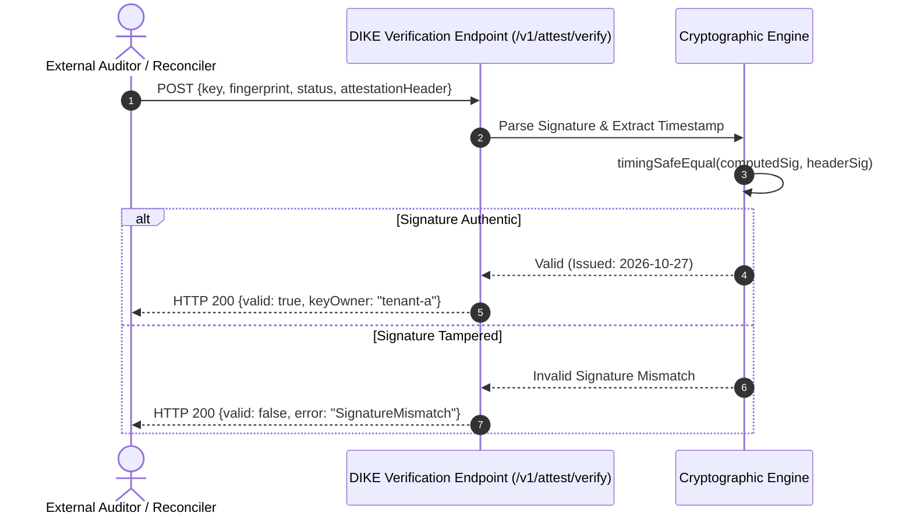

### 3. Technical Specification
- Implement `POST /v1/attest/verify`:
  - Body: `{ idempotencyKey, fingerprint, statusCode, attestationHeader }`
  - Response: `{ valid: true, issuedAt: "2026-10-27T10:00:00Z", keyOwner: "client-abc" }`
- Verifies signature against the configured public key or shared secret.

### 4. Acceptance Criteria
- [ ] Returns `valid: true` for authentic receipts.
- [ ] Returns `valid: false` if any parameter has been altered.

---
title: "Error Status Code Handling & Non-Idempotent Failure Classification"
labels: ["phase:phase-3", "type:reliability", "priority:P1-high", "component:core/error_classifier"]
milestone: "M3: Proxy & Attestation"
---

## Error Status Code Handling & Non-Idempotent Failure Classification

### Target Files
- [`src/core/error_classifier.ts`](file:///c:/Users/USER/Desktop/Extras/pending-projects/DIKE/src/core/error_classifier.ts)

### 1. Problem Statement
Certain upstream failures (e.g. `400 Bad Request`, `404 Not Found`) represent permanent outcomes that should be cached, while transient infrastructure failures (`500 Internal Error`, `502 Bad Gateway`, `503 Unavailable`) must permit immediate retry.

### 2. Technical Specification
- Classify upstream HTTP status codes:
  - **Permanent (Cacheable):** `200..299`, `400`, `404`, `422`.
  - **Transient (Retryable / Evict):** `500`, `502`, `503`, `504`, TCP connection resets.
- For transient failures, release the active lease and transition state to `FAILED` so clients can retry cleanly.

### 3. Classification Decision Tree
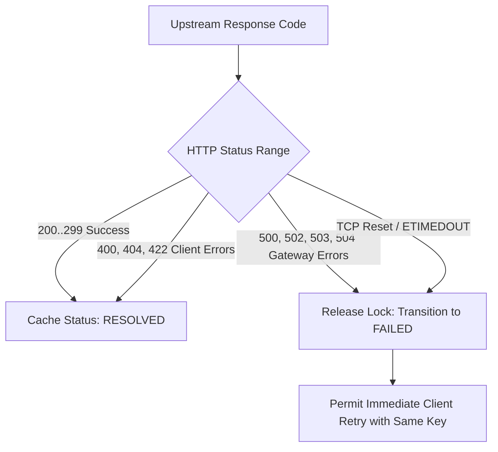

### 4. Acceptance Criteria
- [ ] Upstream 400 responses are cached as resolved.
- [ ] Upstream 503 responses release the lease, allowing immediate client retry.

---
title: "HTTP 304 Not Modified & ETag Co-Existence Handler"
labels: ["phase:phase-3", "type:feature", "priority:P2-medium", "component:proxy/etag"]
milestone: "M3: Proxy & Attestation"
---

## HTTP 304 Not Modified & ETag Co-Existence Handler

### Target Files
- [`src/proxy/etag_handler.ts`](file:///c:/Users/USER/Desktop/Extras/pending-projects/DIKE/src/proxy/etag_handler.ts)

### 1. Problem Statement
When clients send both `If-None-Match` (ETag) and `Idempotency-Key` headers on mutations, the proxy must avoid caching empty 304 response bodies as the canonical idempotent result.

### 2. ETag Handling Sequence Diagram
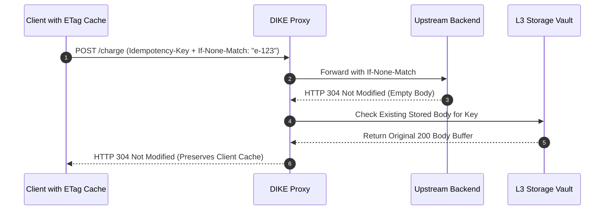

### 3. Technical Specification
- Inspect upstream response for 304 status code.
- If upstream returns 304, preserve existing cached response body from L3 storage rather than overwriting with empty buffer.

### 4. Acceptance Criteria
- [ ] Never overwrites a valid 200/201 response body with a 304 empty payload.
- [ ] Preserves valid ETags on replayed responses.

---
title: "Ephemeral MinIO / S3 Storage Adapter for Large Payloads (> 10MB)"
labels: ["phase:phase-3", "type:feature", "priority:P2-medium", "component:storage/blob"]
milestone: "M3: Proxy & Attestation"
---

## Ephemeral MinIO / S3 Storage Adapter for Large Payloads (> 10MB)

### Target Files
- [`src/storage/blob_storage.ts`](file:///c:/Users/USER/Desktop/Extras/pending-projects/DIKE/src/storage/blob_storage.ts)

### 1. Problem Statement
Storing large response bodies (e.g. 50MB PDF invoice generation) in PostgreSQL `jsonb` causes database bloat and memory pressure.

### 2. Payload Routing Architecture
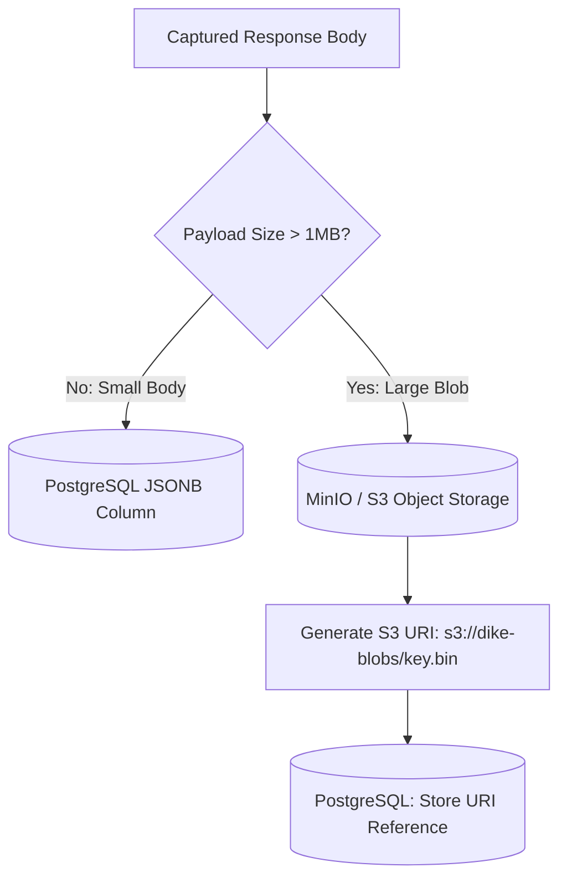

### 3. Technical Specification
- Implement S3/MinIO blob storage adapter.
- Payloads exceeding `BLOB_THRESHOLD_BYTES` (default: 1MB) are written to S3 bucket `dike-payloads`.
- Store S3 URI reference in PostgreSQL record: `response_body_blob_ref`.

### 4. Acceptance Criteria
- [ ] Transparently retrieves and streams large payloads from object storage on cache hit.
- [ ] Configurable lifecycle rule automatically deletes S3 blobs upon key expiry.

---
title: "OpenTelemetry Metrics & Distributed Trace Context Propagation"
labels: ["phase:phase-3", "type:telemetry", "priority:P1-high", "component:telemetry"]
milestone: "M3: Proxy & Attestation"
---

## OpenTelemetry Metrics & Distributed Trace Context Propagation

### Target Files
- [`src/telemetry/metrics.ts`](file:///c:/Users/USER/Desktop/Extras/pending-projects/DIKE/src/telemetry/metrics.ts)
- [`src/telemetry/tracing.ts`](file:///c:/Users/USER/Desktop/Extras/pending-projects/DIKE/src/telemetry/tracing.ts)

### 1. Problem Statement
Operations engineers require real-time visibility into cache hit ratios, lock contention, parking durations, and W3C trace correlation.

### 2. Technical Specification
- Expose `/metrics` endpoint using `prom-client` tracking `dike_requests_total`, `dike_cache_hits_total`, and `dike_parked_connections_active`.
- Extract W3C `traceparent` headers and inject child spans into outbound upstream requests.

### 3. Distributed Trace Span Hierarchy
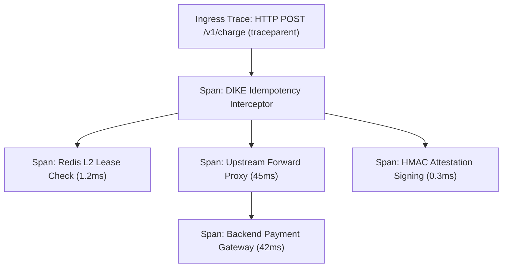

### 4. Acceptance Criteria
- [ ] Exposes Prometheus-compatible metrics at `/metrics`.
- [ ] Trace IDs propagate seamlessly to upstream services without breaking trace graph.

---
title: "End-to-End Reverse Proxy Integration Test Suite with Mock Upstream"
labels: ["phase:phase-3", "type:test", "priority:P0-critical", "component:testing/proxy"]
milestone: "M3: Proxy & Attestation"
---

## End-to-End Reverse Proxy Integration Test Suite with Mock Upstream

### Target Files
- [`tests/integration/proxy.test.ts`](file:///c:/Users/USER/Desktop/Extras/pending-projects/DIKE/tests/integration/proxy.test.ts)

### 1. Problem Statement
Ensure the entire proxy pipeline functions cohesively against real HTTP upstream servers before release.

### 2. Full Proxy Loop Verification Diagram
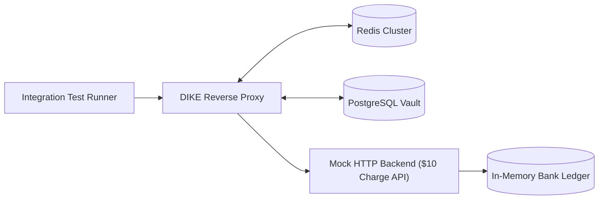

### 3. Technical Specification
- Spin up mock HTTP upstream service (charging $10 per call).
- Route client mutation traffic through DIKE reverse proxy.
- Assert that:
  1. First call charges $10 and returns 201 Created.
  2. Second call with identical key returns 201 Created immediately without hitting mock server.
  3. Third call with altered amount returns 422 Unprocessable Entity.

### 4. Acceptance Criteria
- [ ] Full end-to-end integration pass verifying the complete proxy loop.
- [ ] Verified proxy overhead $< 2.0ms$ p99.
