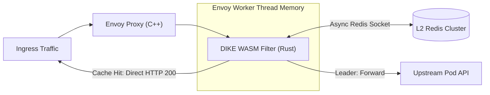
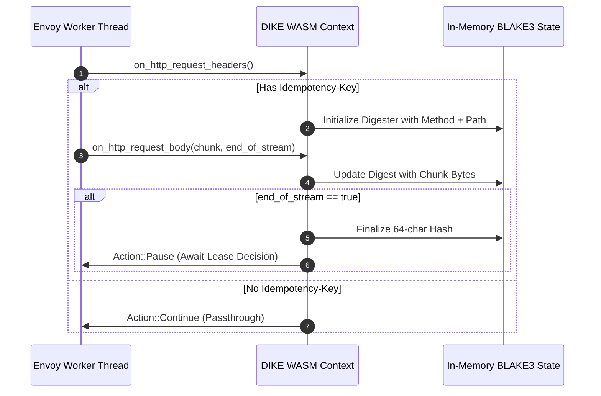
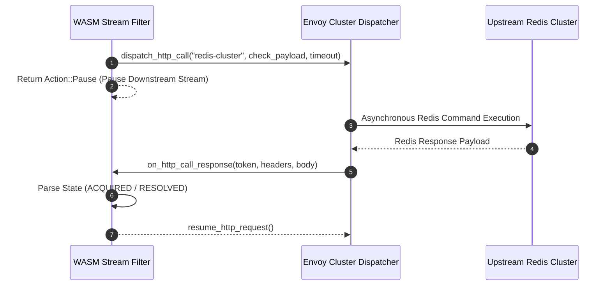
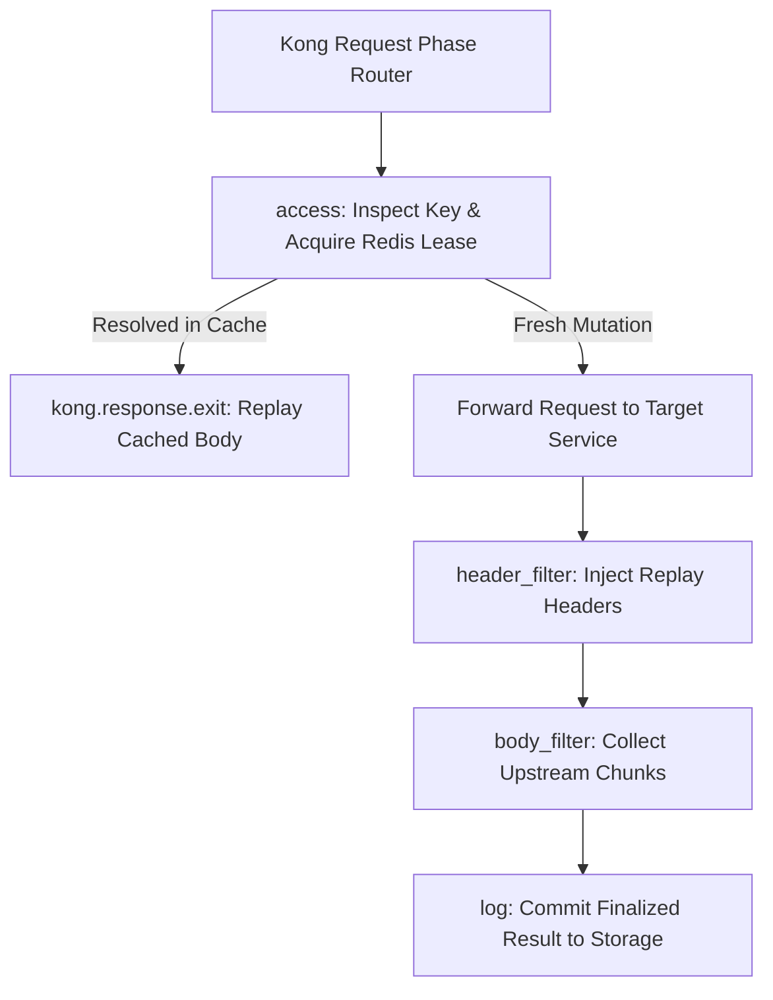
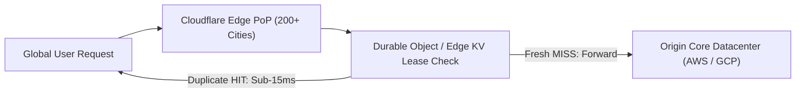
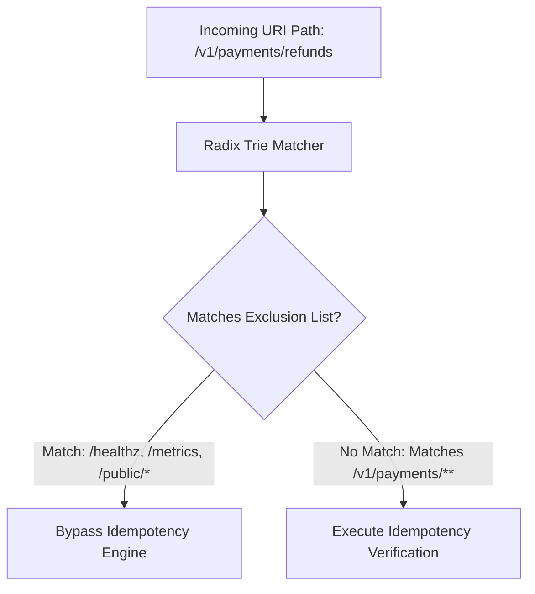
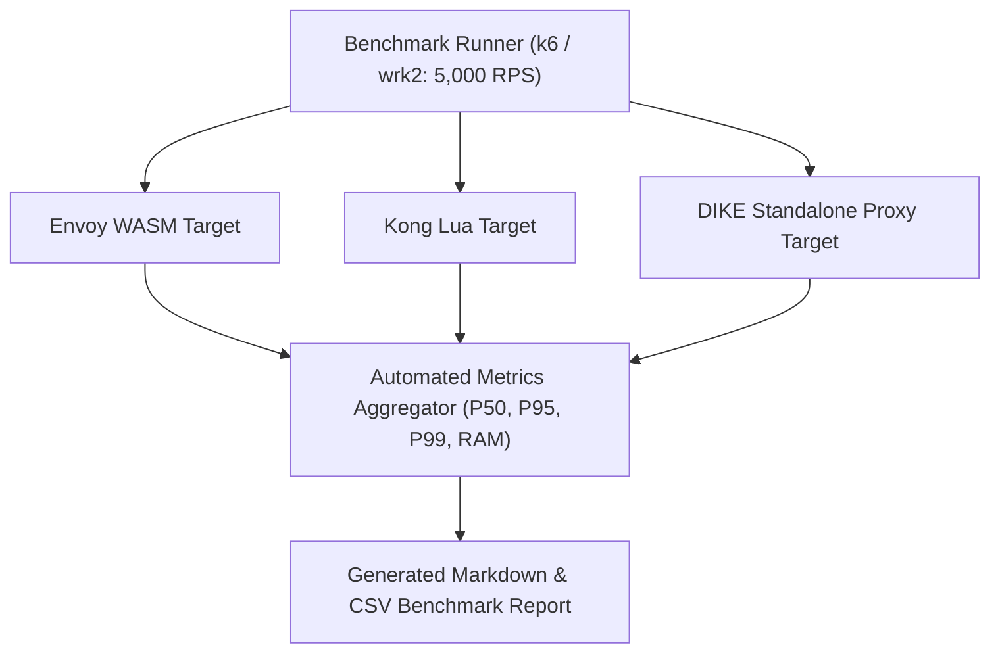
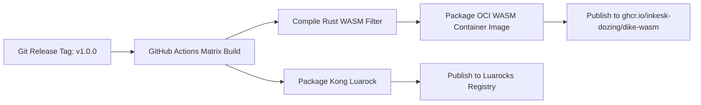

# Phase 4: Gateway Ecosystem & Native Plugins

This document details all Phase 4 implementation issues for the Distributed Idempotency Key Engine (DIKE), focusing on native service mesh filters, Envoy WebAssembly (WASM) plugins, Kong Gateway integrations, Cloudflare edge workers, and ingress policy enforcement.

---
title: "Envoy Proxy WebAssembly (WASM) Filter Architecture in Rust"
labels: ["phase:phase-4", "type:feature", "priority:P0-critical", "component:mesh/envoy"]
milestone: "M4: Gateway Ecosystem & Plugins"
---

## Envoy Proxy WebAssembly (WASM) Filter Architecture in Rust

### Target Files
- [`plugins/envoy-wasm/Cargo.toml`](file:///c:/Users/USER/Desktop/Extras/pending-projects/DIKE/plugins/envoy-wasm/Cargo.toml)
- [`plugins/envoy-wasm/src/lib.rs`](file:///c:/Users/USER/Desktop/Extras/pending-projects/DIKE/plugins/envoy-wasm/src/lib.rs)

### 1. Problem Statement
High-throughput Kubernetes clusters running Istio or Envoy cannot afford the latency of routing requests through an external sidecar proxy. DIKE must execute directly inside Envoy's worker threads via WebAssembly.

### 2. Architecture Diagram


### 3. Technical Specification
- Implement Rust crate targeting `wasm32-unknown-unknown` using `proxy-wasm`.
- Compile to `.wasm` bytecode compatible with Envoy 1.28+.
- Implement Envoy root context and stream context hooks:
  - `on_http_request_headers`
  - `on_http_request_body`
  - `on_http_response_headers`
  - `on_http_response_body`

### 4. Acceptance Criteria
- [ ] Compiles to $< 2MB$ optimized WebAssembly binary.
- [ ] Passes Envoy WASM test harness with zero memory leaks.

---
title: "Envoy WASM HTTP Header & Streaming Body Digest Interceptor"
labels: ["phase:phase-4", "type:feature", "priority:P0-critical", "component:mesh/envoy"]
milestone: "M4: Gateway Ecosystem & Plugins"
---

## Envoy WASM HTTP Header & Streaming Body Digest Interceptor

### Target Files
- [`plugins/envoy-wasm/src/filter.rs`](file:///c:/Users/USER/Desktop/Extras/pending-projects/DIKE/plugins/envoy-wasm/src/filter.rs)

### 1. Problem Statement
The Envoy filter must inspect the `Idempotency-Key` header, compute the BLAKE3 digest of the body buffer across chunks, and decide whether to pause the filter or stream downstream.

### 2. WASM Streaming Digest Lifecycle Diagram


### 3. Technical Specification
- Intercept `Idempotency-Key` header in `on_http_request_headers`.
- Buffer incoming request body chunks in `on_http_request_body` until end-of-stream.
- Compute BLAKE3 digest using SIMD-accelerated Rust BLAKE3 crate.

### 4. Acceptance Criteria
- [ ] Immediately halts and replays cached response if key is already resolved.
- [ ] Forwards fresh mutations seamlessly to upstream cluster.

---
title: "Envoy Asynchronous Redis Client via Envoy Cluster Protocol"
labels: ["phase:phase-4", "type:feature", "priority:P1-high", "component:mesh/envoy"]
milestone: "M4: Gateway Ecosystem & Plugins"
---

## Envoy Asynchronous Redis Client via Envoy Cluster Protocol

### Target Files
- [`plugins/envoy-wasm/src/redis.rs`](file:///c:/Users/USER/Desktop/Extras/pending-projects/DIKE/plugins/envoy-wasm/src/redis.rs)

### 1. Problem Statement
WebAssembly in Envoy cannot open raw TCP sockets; it must make asynchronous network calls through Envoy’s internal cluster dispatch subsystem without stalling worker threads.

### 2. Envoy Dispatch Sequence Diagram


### 3. Technical Specification
- Use `dispatch_http_call` or custom Envoy Redis filter protocol to query DIKE control plane or Redis cluster asynchronously.
- Resume stream filter (`Action::Continue`) upon callback receipt.

### 4. Acceptance Criteria
- [ ] Asynchronously checks idempotency lease without blocking Envoy worker thread.
- [ ] Handles Redis timeout gracefully.

---
title: "Kong Gateway Native Plugin in Lua (`kong-plugin-dike`)"
labels: ["phase:phase-4", "type:feature", "priority:P1-high", "component:gateway/kong"]
milestone: "M4: Gateway Ecosystem & Plugins"
---

## Kong Gateway Native Plugin in Lua (`kong-plugin-dike`)

### Target Files
- [`plugins/kong/handler.lua`](file:///c:/Users/USER/Desktop/Extras/pending-projects/DIKE/plugins/kong/handler.lua)
- [`plugins/kong/schema.lua`](file:///c:/Users/USER/Desktop/Extras/pending-projects/DIKE/plugins/kong/schema.lua)

### 1. Problem Statement
Enterprises leveraging Kong Gateway require a first-class plugin installable via Luarocks without modifying application pod configurations.

### 2. Kong Hook Lifecycle Architecture


### 3. Technical Specification
- Implement Kong handler hooks:
  - `access(conf)`: Check and acquire lease in Redis.
  - `header_filter(conf)`: Inject replay and attestation headers.
  - `body_filter(conf)`: Capture response body and commit to storage.

### 4. Acceptance Criteria
- [ ] Published as standard Luarocks rock: `kong-plugin-dike`.
- [ ] Fully functional when enabled on Kong Service or Route entities.

---
title: "Cloudflare Edge Worker Idempotency Gate"
labels: ["phase:phase-4", "type:feature", "priority:P1-high", "component:edge/cloudflare"]
milestone: "M4: Gateway Ecosystem & Plugins"
---

## Cloudflare Edge Worker Idempotency Gate

### Target Files
- [`plugins/cloudflare-worker/src/index.ts`](file:///c:/Users/USER/Desktop/Extras/pending-projects/DIKE/plugins/cloudflare-worker/src/index.ts)

### 1. Problem Statement
SaaS platforms require edge-level deduplication to stop duplicate traffic before it ever hits origin load balancers across global regions.

### 2. Edge to Origin Architecture Flow


### 3. Technical Specification
- Implement Cloudflare Worker script using Cloudflare KV or Durable Objects for atomic coordination.
- Compute SHA-256 digest using Web Crypto API.
- Return cached response directly from Cloudflare Edge PoP.

### 4. Acceptance Criteria
- [ ] Executes in $< 15ms$ at Cloudflare edge data centers globally.
- [ ] Prevents duplicate requests from reaching origin data centers.

---
title: "Dynamic Route Matching & Regex Path Exclusion Engine"
labels: ["phase:phase-4", "type:feature", "priority:P2-medium", "component:gateway/matching"]
milestone: "M4: Gateway Ecosystem & Plugins"
---

## Dynamic Route Matching & Regex Path Exclusion Engine

### Target Files
- [`src/proxy/matcher.ts`](file:///c:/Users/USER/Desktop/Extras/pending-projects/DIKE/src/proxy/matcher.ts)

### 1. Problem Statement
Gateways must ignore health checks, metrics, and non-financial routes without invoking Redis.

### 2. Radix Path Matcher Diagram


### 3. Technical Specification
- Implement Radix-tree path matcher supporting wildcards and regex (`/v1/payments/**`, `!/v1/payments/health`).

### 4. Acceptance Criteria
- [ ] Evaluates path exclusion rules in $< 100$ nanoseconds.
- [ ] Non-matching routes bypass idempotency engine completely.

---
title: "Fail-Open vs. Fail-Closed Policy Enforcement on Gateway Errors"
labels: ["phase:phase-4", "type:reliability", "priority:P1-high", "component:gateway/policy"]
milestone: "M4: Gateway Ecosystem & Plugins"
---

## Fail-Open vs. Fail-Closed Policy Enforcement on Gateway Errors

### Target Files
- [`src/core/failure_policy.ts`](file:///c:/Users/USER/Desktop/Extras/pending-projects/DIKE/src/core/failure_policy.ts)

### 1. Problem Statement
If the idempotency cluster is degraded, non-critical services prefer failing open (allowing duplicates to preserve availability), while financial services demand failing closed (rejecting mutations to prevent double-charging).

### 2. Policy Enforcement Flowchart
```mermaid
flowchart TD
    Error[Storage Connectivity Failure Detected] --> PolicyCheck{Configured Policy}
    PolicyCheck -->|FAIL_CLOSED (Financial Mode)| Reject[Emit HTTP 503 Service Unavailable]
    PolicyCheck -->|FAIL_OPEN (Availability Mode)| Warn[Log Critical Telemetry Warning]
    Warn --> Forward[Forward Request to Upstream Unchecked]
```

### 3. Technical Specification
- Add configuration flag: `ON_STORAGE_FAILURE: 'FAIL_CLOSED' | 'FAIL_OPEN'`.
- If `FAIL_CLOSED`, return `503 Service Unavailable`.
- If `FAIL_OPEN`, log warning and forward request upstream without idempotency tracking.

### 4. Acceptance Criteria
- [ ] Accurately toggles behavior based on per-route policy configuration.

---
title: "Cross-Gateway Performance Benchmark Suite"
labels: ["phase:phase-4", "type:benchmark", "priority:P1-high", "component:benchmarks"]
milestone: "M4: Gateway Ecosystem & Plugins"
---

## Cross-Gateway Performance Benchmark Suite

### Target Files
- [`benchmarks/gateway_comparison.sh`](file:///c:/Users/USER/Desktop/Extras/pending-projects/DIKE/benchmarks/gateway_comparison.sh)

### 1. Problem Statement
Provide transparent, empirical benchmark data comparing latency across Envoy WASM, Kong Lua, Traefik, and DIKE Standalone Proxy under identical traffic loads.

### 2. Benchmark Evaluation Architecture


### 3. Technical Specification
- Benchmark all configurations under identical hardware and 5,000 RPS load.
- Publish latency comparison table (p50, p95, p99, memory footprint).

### 4. Acceptance Criteria
- [ ] Automated reproducible benchmark script generates CSV and Markdown reports.

---
title: "Plugin Packaging & Automated OCI Container Image Publishing"
labels: ["phase:phase-4", "type:devops", "priority:P1-high", "component:ci/release"]
milestone: "M4: Gateway Ecosystem & Plugins"
---

## Plugin Packaging & Automated OCI Container Image Publishing

### Target Files
- [`.github/workflows/plugins.yml`](file:///c:/Users/USER/Desktop/Extras/pending-projects/DIKE/.github/workflows/plugins.yml)

### 1. Problem Statement
All gateway plugins (WASM, Kong rock, Nginx module) must be automatically built, tested, and published to GitHub Packages and Docker Hub without manual developer intervention.
- **CI/CD Build & OCI Publish Pipeline**:


### 2. Technical Specification
- Configure GitHub Actions matrix building Rust WASM, Luarocks, and Docker images.
- Publish `ghcr.io/inkesk-dozing/dike-wasm:latest`.

### 3. Acceptance Criteria
- [ ] Automatically produces signed WASM and container artifacts on tagged releases.
