# Phase 5: Developer Console & Audit Web UI

This document details all Phase 5 implementation issues for the Distributed Idempotency Key Engine (DIKE), focusing on the developer management web console, live transaction inspector, real-time unparking telemetry, visual payload diffing, and RBAC authentication.

---
title: "React 19 + Tailwind CSS + Vite Frontend Scaffolding"
labels: ["phase:phase-5", "type:feature", "priority:P0-critical", "component:ui/scaffolding"]
milestone: "M5: Developer Console & Audit UI"
---

## React 19 + Tailwind CSS + Vite Frontend Scaffolding

### Target Files
- [`apps/console/package.json`](file:///c:/Users/USER/Desktop/Extras/pending-projects/DIKE/apps/console/package.json)
- [`apps/console/vite.config.ts`](file:///c:/Users/USER/Desktop/Extras/pending-projects/DIKE/apps/console/vite.config.ts)
- [`apps/console/tailwind.config.js`](file:///c:/Users/USER/Desktop/Extras/pending-projects/DIKE/apps/console/tailwind.config.js)

### 1. Problem Statement
Operations engineers and support teams need a dedicated, modern Single Page Application (SPA) to inspect transactions, monitor active parked connections, and investigate payload mismatch rejections.

### 2. Console Layout Diagram
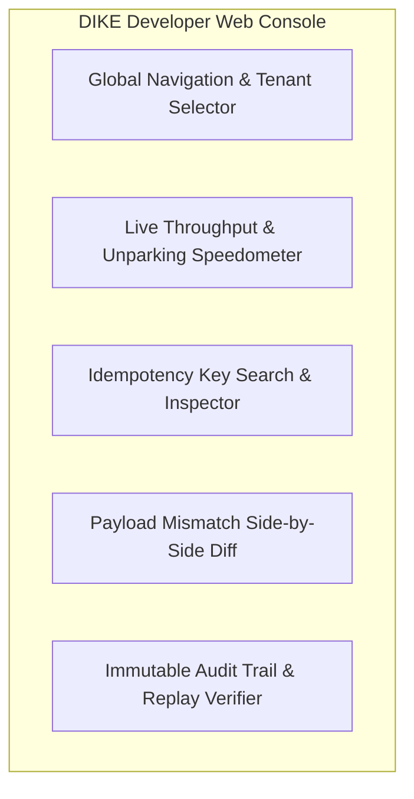

### 3. Technical Specification
- Scaffold Vite React 19 application with TypeScript and Tailwind CSS.
- Implement Lucide icons and shadcn/ui accessible component primitives.
- Configure TanStack Query v5 for server-state caching and automatic polling.

### 4. Acceptance Criteria
- [ ] Compiles into static `/dist` directory in $< 5$ seconds.
- [ ] Responsive across desktop, tablet, and mobile displays.

---
title: "Admin REST API (`/admin/v1/*`)"
labels: ["phase:phase-5", "type:feature", "priority:P0-critical", "component:server/admin_api"]
milestone: "M5: Developer Console & Audit UI"
---

## Admin REST API (`/admin/v1/*`)

### Target Files
- [`src/server/routes/admin.ts`](file:///c:/Users/USER/Desktop/Extras/pending-projects/DIKE/src/server/routes/admin.ts)

### 1. Problem Statement
The developer console requires secure, paginated backend endpoints to query records, audit trails, and live cluster state without querying raw PostgreSQL tables.

### 2. Admin API Endpoints Architecture
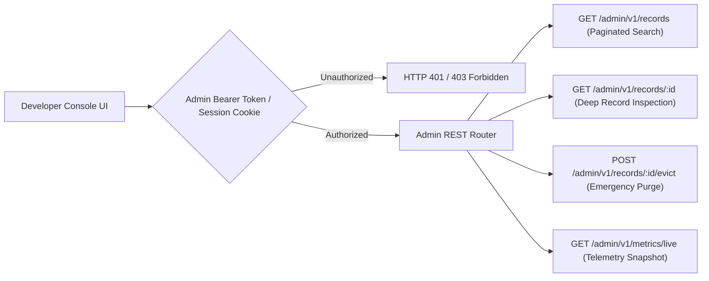

### 3. Technical Specification
- Implement endpoints:
  - `GET /admin/v1/records?tenantId=&status=&query=&page=&limit=`
  - `GET /admin/v1/records/:id`
  - `POST /admin/v1/records/:id/evict`
  - `GET /admin/v1/metrics/live`
- Protect with separate Admin API key or JWT bearer token.

### 4. Acceptance Criteria
- [ ] Paginates cleanly across 1,000,000+ records in PostgreSQL with $< 50ms$ query time.
- [ ] Requires administrative privileges; non-admin tokens return 403 Forbidden.

---
title: "Live Key Inspector & Transaction Replay Explorer"
labels: ["phase:phase-5", "type:feature", "priority:P0-critical", "component:ui/inspector"]
milestone: "M5: Developer Console & Audit UI"
---

## Live Key Inspector & Transaction Replay Explorer

### Target Files
- [`apps/console/src/pages/KeyInspector.tsx`](file:///c:/Users/USER/Desktop/Extras/pending-projects/DIKE/apps/console/src/pages/KeyInspector.tsx)

### 1. Problem Statement
When a customer reports an issue with a payment, support teams must instantly look up the `Idempotency-Key` to verify if it was a live mutation or a replayed cache hit.

### 2. Key Inspection Data Flow Diagram
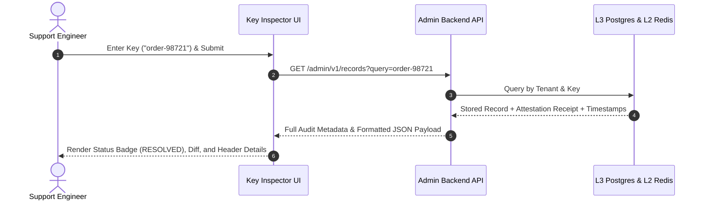

### 3. Technical Specification
- Dedicated search bar accepting `Idempotency-Key` or `trace_id`.
- Detailed view rendering:
  - Status badge (`STARTED`, `RESOLVED`, `FAILED`).
  - Exact timestamp of initial call vs. replay calls.
  - Upstream HTTP status code and response headers.
  - JSON payload viewer with syntax highlighting and copy-to-clipboard.

### 4. Acceptance Criteria
- [ ] Renders key details in $< 200ms$.
- [ ] Displays attestation signature verification status badge.

---
title: "Visual Payload Diff Viewer for 422 Mismatch Investigation"
labels: ["phase:phase-5", "type:feature", "priority:P1-high", "component:ui/diff_viewer"]
milestone: "M5: Developer Console & Audit UI"
---

## Visual Payload Diff Viewer for 422 Mismatch Investigation

### Target Files
- [`apps/console/src/components/PayloadDiff.tsx`](file:///c:/Users/USER/Desktop/Extras/pending-projects/DIKE/apps/console/src/components/PayloadDiff.tsx)

### 1. Problem Statement
When an API client receives `422 Payload Mismatch`, developers need to see exactly which field in the JSON body differed from the original request.

### 2. Side-by-Side Diff Resolution Flow
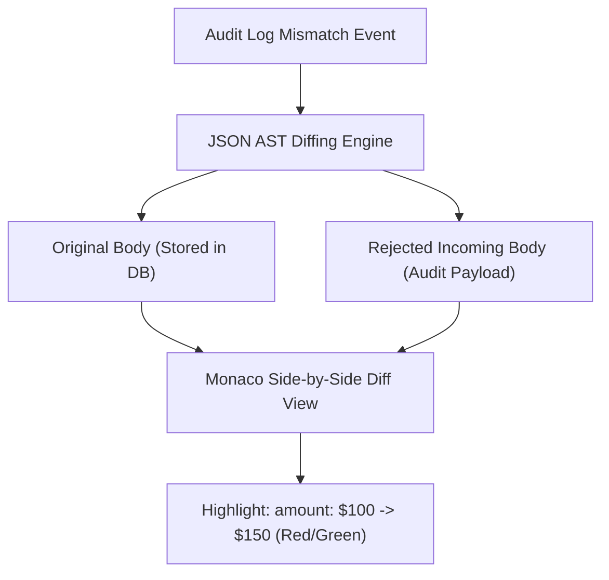

### 3. Technical Specification
- Integrate Monaco Editor or `react-diff-viewer`.
- Display side-by-side comparison:
  - Left: Original Request Body (Stored in L3).
  - Right: Conflicting Incoming Request Body (Captured in Audit Log).
- Highlight added, removed, or modified JSON properties in red/green.

### 4. Acceptance Criteria
- [ ] Side-by-side diff clearly highlights differing JSON properties.
- [ ] Helps developers diagnose client bugs within seconds.

---
title: "Real-Time Connection Parking Telemetry & Latency Speedometer"
labels: ["phase:phase-5", "type:feature", "priority:P1-high", "component:ui/realtime"]
milestone: "M5: Developer Console & Audit UI"
---

## Real-Time Connection Parking Telemetry & Latency Speedometer

### Target Files
- [`apps/console/src/components/ParkingTelemetry.tsx`](file:///c:/Users/USER/Desktop/Extras/pending-projects/DIKE/apps/console/src/components/ParkingTelemetry.tsx)

### 1. Problem Statement
Site Reliability Engineers need a visual gauge of how many connections are currently parked in memory and the average duration before they are unparked.

### 2. WebSocket Telemetry Stream Sequence Diagram
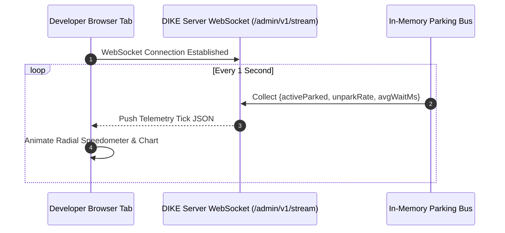

### 3. Technical Specification
- Establish WebSocket connection to DIKE server (`ws://localhost:3000/admin/v1/stream`).
- Broadcast live telemetry tick every second:
  `{ activeParked: number, unparkingRate: number, avgWaitMs: number }`.
- Render animated radial gauge (speedometer) and rolling line chart.

### 4. Acceptance Criteria
- [ ] Updates smoothly in real time without browser tab lag.
- [ ] Automatically alerts if parked connection count crosses threshold.

---
title: "Manual Key Invalidation & Emergency Eviction Action Modal"
labels: ["phase:phase-5", "type:feature", "priority:P1-high", "component:ui/eviction"]
milestone: "M5: Developer Console & Audit UI"
---

## Manual Key Invalidation & Emergency Eviction Action Modal

### Target Files
- [`apps/console/src/components/EvictKeyModal.tsx`](file:///c:/Users/USER/Desktop/Extras/pending-projects/DIKE/apps/console/src/components/EvictKeyModal.tsx)

### 1. Problem Statement
If a third-party upstream API hanged and left a key stuck in `STARTED` state, administrators must be able to manually release or delete the key.

### 2. Eviction Audit Sequence Diagram
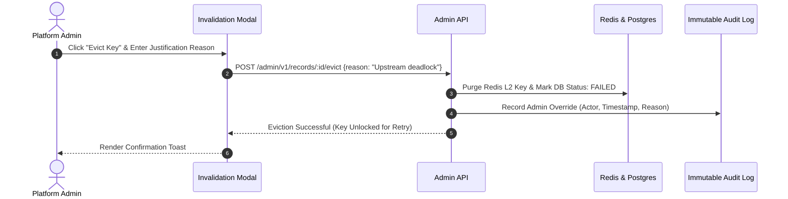

### 3. Technical Specification
- Implement "Emergency Release Key" button in UI.
- Prompts confirmation modal requiring admin to enter a justification reason.
- Invokes `POST /admin/v1/records/:id/evict`.
- Writes an entry to the immutable audit log recording the administrator's email and justification.

### 4. Acceptance Criteria
- [ ] Immediately purges key from L1 memory, L2 Redis, and updates L3 database status to `FAILED`.
- [ ] Creates permanent audit entry tracking the administrative override.

---
title: "Role-Based Access Control (RBAC) & SAML/OIDC Single Sign-On"
labels: ["phase:phase-5", "type:security", "priority:P0-critical", "component:ui/auth"]
milestone: "M5: Developer Console & Audit UI"
---

## Role-Based Access Control (RBAC) & SAML/OIDC Single Sign-On

### Target Files
- [`apps/console/src/auth/`](file:///c:/Users/USER/Desktop/Extras/pending-projects/DIKE/apps/console/src/auth/)

### 1. Problem Statement
Enterprise compliance prevents using shared passwords. The web console must integrate with corporate identity providers (Okta, Google Workspace, Azure AD).
- **SSO Login & Role Resolution Sequence Diagram**:
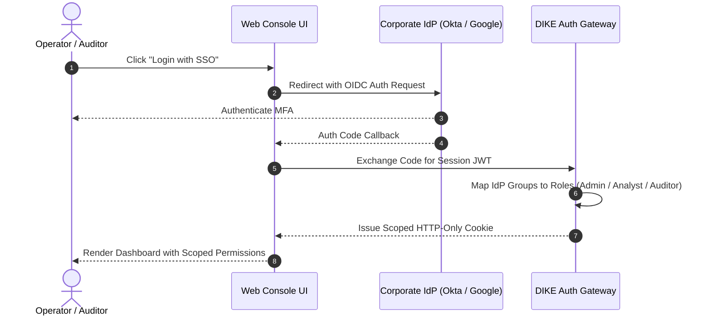

### 2. Technical Specification
- Implement OIDC / SAML 2.0 authentication flow.
- Define roles:
  - `PlatformAdmin`: Full read, write, key eviction, and tenant provisioning.
  - `SupportAnalyst`: Read-only key inspection and payload diffing.
  - `Auditor`: Export audit logs and cryptographic attestation receipts.

### 3. Acceptance Criteria
- [ ] Enforces role restrictions across all UI views and API endpoints.
- [ ] Supports corporate Single Sign-On (SSO) login.

---
title: "Immutable Audit Trail Table & Compliance Log Viewer"
labels: ["phase:phase-5", "type:feature", "priority:P1-high", "component:ui/audit_trail"]
milestone: "M5: Developer Console & Audit UI"
---

## Immutable Audit Trail Table & Compliance Log Viewer

### Target Files
- [`apps/console/src/pages/AuditTrail.tsx`](file:///c:/Users/USER/Desktop/Extras/pending-projects/DIKE/apps/console/src/pages/AuditTrail.tsx)

### 1. Problem Statement
Financial compliance auditors (SOC2, PCI-DSS) need an exportable ledger of all key creations, cache hits, rejections, and administrative actions.
- **Audit Query & CSV Export Pipeline**:
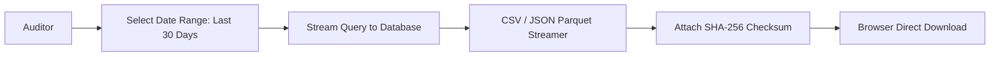

### 2. Technical Specification
- Paginated audit ledger table with date-range filters.
- Column fields: Timestamp, Event Type, Tenant, Client Key, Caller IP, Status.
- "Export CSV" and "Export JSON" action buttons.

### 3. Acceptance Criteria
- [ ] Exports up to 100,000 audit records into a signed CSV file.
- [ ] Filters by date range, IP address, or event type in $< 100ms$.

---
title: "Dark Mode & Accessible Design System (WCAG 2.1 AA Compliant)"
labels: ["phase:phase-5", "type:ui", "priority:P2-medium", "component:ui/theme"]
milestone: "M5: Developer Console & Audit UI"
---

## Dark Mode & Accessible Design System (WCAG 2.1 AA Compliant)

### Target Files
- [`apps/console/src/theme/`](file:///c:/Users/USER/Desktop/Extras/pending-projects/DIKE/apps/console/src/theme/)

### 1. Problem Statement
Developer tools must provide a sleek, polished dark mode while maintaining full keyboard accessibility and color contrast compliance.
- **Theme Token & Accessibility Architecture**:
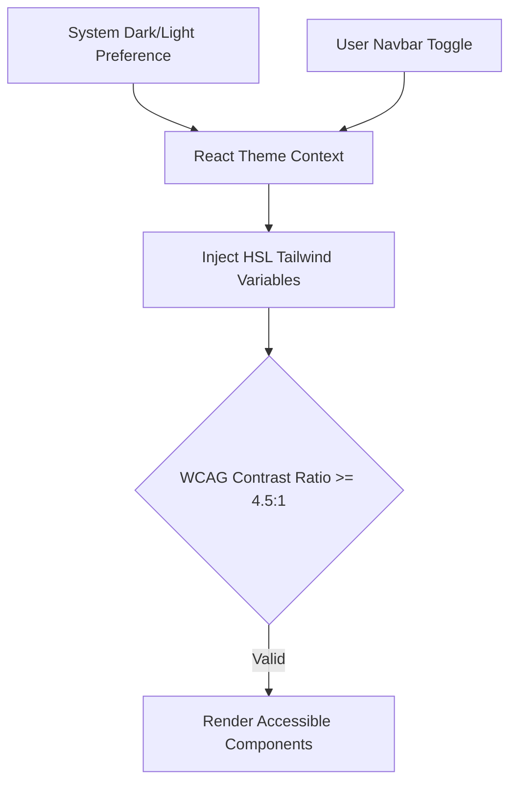

### 2. Technical Specification
- Support automatic system theme detection with manual light/dark toggle.
- Ensure minimum 4.5:1 color contrast ratio across all text elements.
- Full keyboard navigation and ARIA landmarks for screen readers.

### 3. Acceptance Criteria
- [ ] Passes automated Axe Accessibility audit with zero violations.
- [ ] Smooth transitions between light and dark modes.

---
title: "Interactive Metric Charts: Hit Ratios & Contention Heatmaps"
labels: ["phase:phase-5", "type:feature", "priority:P2-medium", "component:ui/charts"]
milestone: "M5: Developer Console & Audit UI"
---

## Interactive Metric Charts: Hit Ratios & Contention Heatmaps

### Target Files
- [`apps/console/src/components/MetricsCharts.tsx`](file:///c:/Users/USER/Desktop/Extras/pending-projects/DIKE/apps/console/src/components/MetricsCharts.tsx)

### 1. Problem Statement
Engineers need visual insights into traffic patterns, percentage of saved duplicate requests, and peak contention hours.
- **Time-Series Metric Ingestion & Rendering Diagram**:
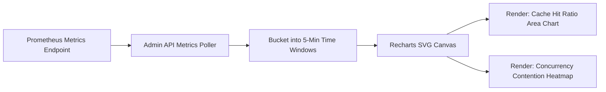

### 2. Technical Specification
- Implement time-series area charts using Recharts or Tremor.
- Visualize:
  - 24-hour Cache Hit Ratio (`HIT` vs `MISS`).
  - Hourly duplicate contention spikes.
  - P99 upstream latency vs. DIKE cached latency.

### 3. Acceptance Criteria
- [ ] Interactive tooltips display granular metrics on hover.
- [ ] Smooth rendering across 1,000+ data points.

---
title: "Embedded Static Asset Serving inside DIKE Control Plane Binary"
labels: ["phase:phase-5", "type:feature", "priority:P1-high", "component:server/static"]
milestone: "M5: Developer Console & Audit UI"
---

## Embedded Static Asset Serving inside DIKE Control Plane Binary

### Target Files
- [`src/server/plugins/static_console.ts`](file:///c:/Users/USER/Desktop/Extras/pending-projects/DIKE/src/server/plugins/static_console.ts)

### 1. Problem Statement
Running a separate web server container just for the console increases operational complexity. The console SPA should be optionally served directly from the DIKE backend binary.

### 2. In-Memory Static Asset Architecture Diagram
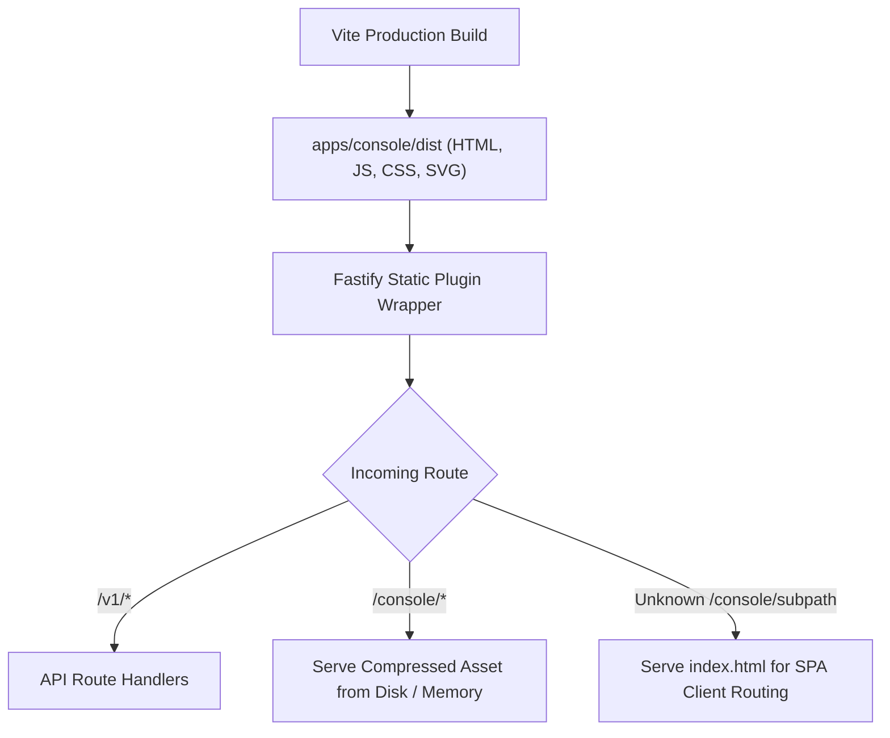

### 3. Technical Specification
- Bundle compiled console `/dist` assets into DIKE server.
- Serve static SPA at `GET /console/*` using `@fastify/static`.
- Support fallback to `index.html` for client-side routing.

### 4. Acceptance Criteria
- [ ] Opening `http://localhost:3000/console` renders the full UI without a separate web container.
- [ ] Gzip/Brotli compression enabled for all static assets.

---
title: "Playwright End-to-End Automated UI Test Suite"
labels: ["phase:phase-5", "type:test", "priority:P1-high", "component:testing/e2e"]
milestone: "M5: Developer Console & Audit UI"
---

## Playwright End-to-End Automated UI Test Suite

### Target Files
- [`tests/e2e/console.spec.ts`](file:///c:/Users/USER/Desktop/Extras/pending-projects/DIKE/tests/e2e/console.spec.ts)

### 1. Problem Statement
Ensure all critical UI flows (key lookup, payload diffing, manual eviction) function properly across Chrome, Firefox, and Safari in headless CI environments.

### 2. Headless Browser Test Execution Flowchart
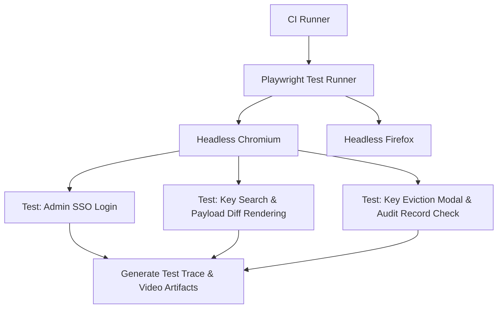

### 3. Technical Specification
- Write Playwright E2E test scenarios:
  1. Log in with admin credentials.
  2. Search for a simulated idempotency key.
  3. Verify payload diff renders highlighted discrepancies.
  4. Execute key eviction and verify state change to `FAILED`.

### 4. Acceptance Criteria
- [ ] 100% passing automated Playwright tests in headless CI.
