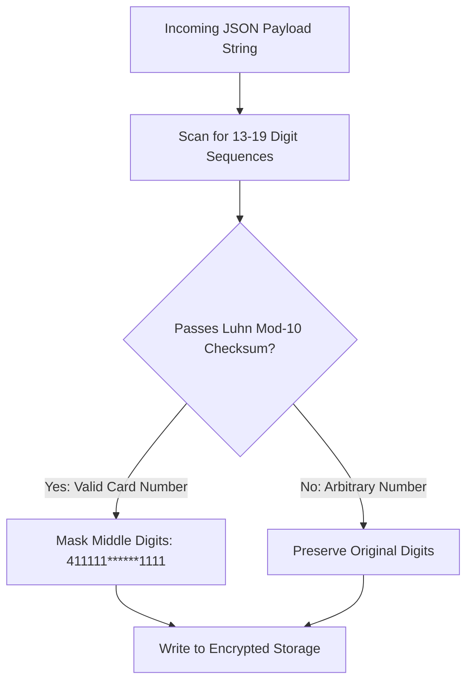
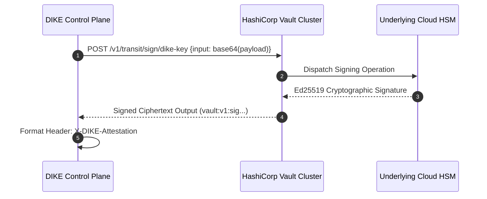
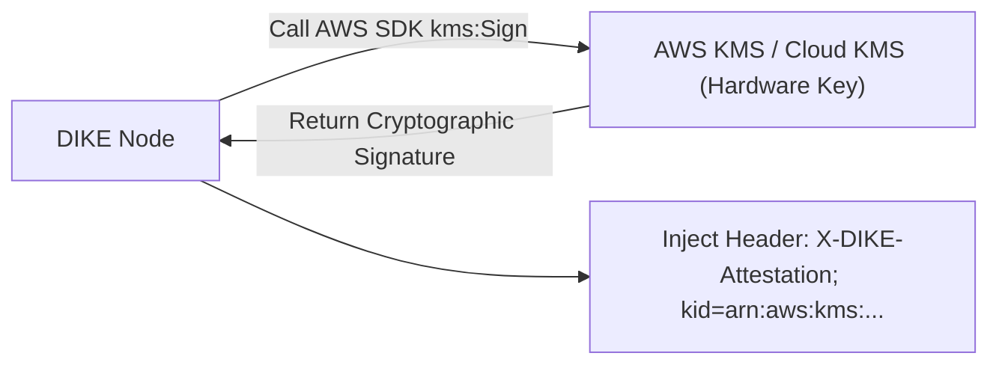
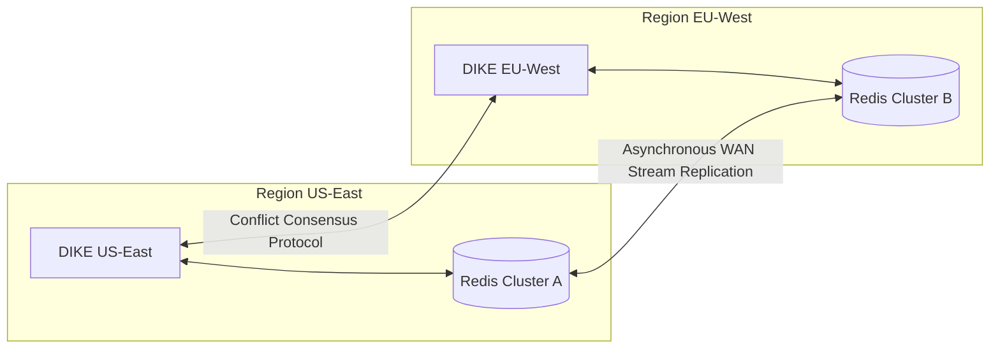
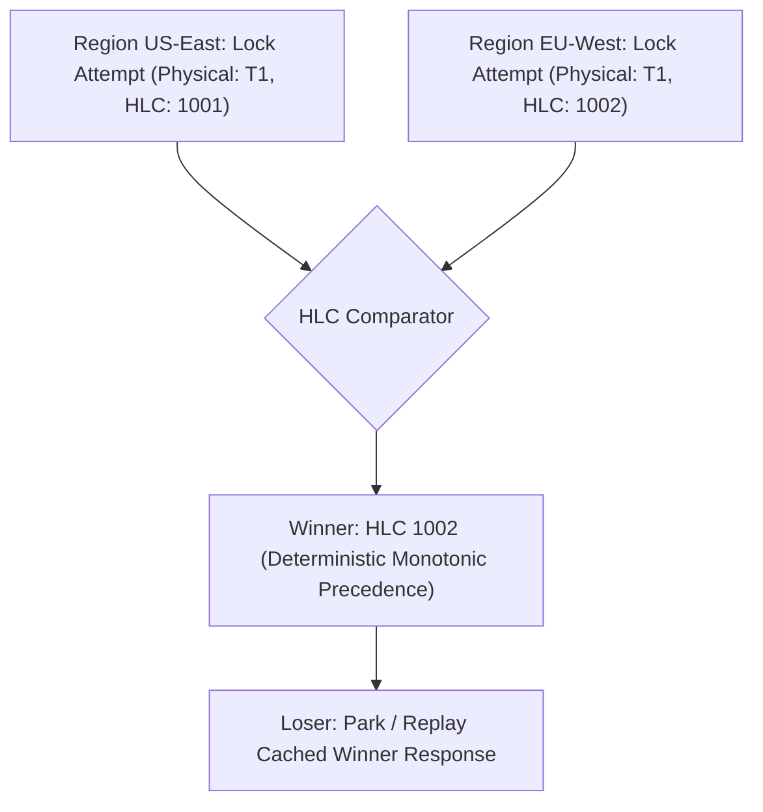
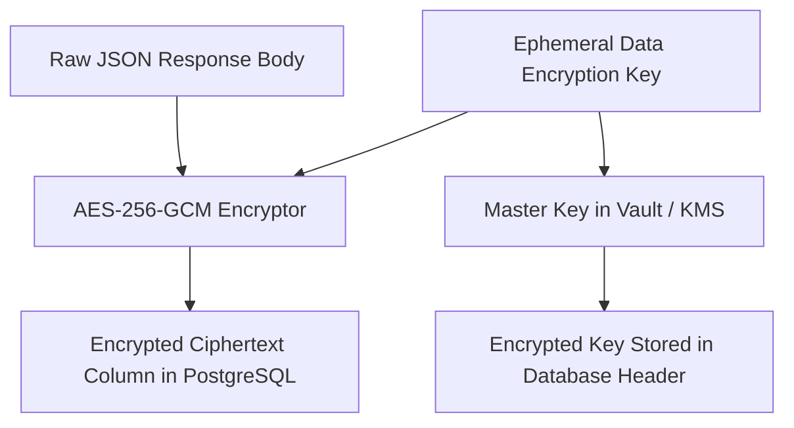
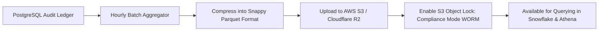
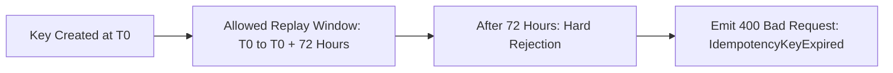
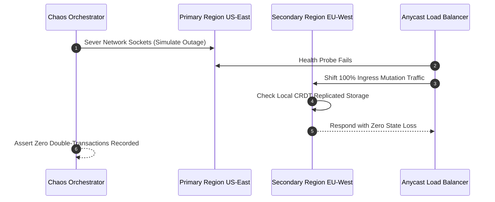

# Phase 6: Advanced Security & Multi-Region Replication

This document details all Phase 6 implementation issues for the Distributed Idempotency Key Engine (DIKE), focusing on semantic JSON payload hashing, PCI-DSS compliance masking, HashiCorp Vault / AWS KMS integration, active-active multi-region replication, and enterprise audit pipelines.

---
title: "Semantic JSON Hashing & Dynamic Ignore-Path Engine"
labels: ["phase:phase-6", "type:feature", "priority:P0-critical", "component:core/semantic_hasher"]
milestone: "M6: Advanced Security & Multi-Region"
---

## Semantic JSON Hashing & Dynamic Ignore-Path Engine

### Target Files
- [`src/core/semantic_hasher.ts`](file:///c:/Users/USER/Desktop/Extras/pending-projects/DIKE/src/core/semantic_hasher.ts)

### 1. Problem Statement
In real-world APIs, requests with identical business intent frequently carry dynamic, non-idempotent metadata (e.g. `clientTimestamp`, `nonce`, or tracing UUIDs). A naive bitwise hash flags these as false-positive `422 Payload Mismatch` errors.

### 2. Data Flow Diagram

### 3. Technical Specification
- Parse JSON body into canonical Abstract Syntax Tree (AST).
- Strip fields matching configured JSONPointer or glob patterns (e.g. `["meta.nonce", "timestamp", "headers.x-request-id"]`).
- Sort object keys alphabetically to guarantee deterministic ordering.
- Stream the canonical normalized string through BLAKE3.

### 4. Acceptance Criteria
- [ ] Requests differing only by ignored fields produce the exact same fingerprint.
- [ ] Requests with differing business values (e.g. `amount`) produce distinct fingerprints.

---
title: "Automated PCI-DSS PAN Masking & Sensitive Field Redaction"
labels: ["phase:phase-6", "type:security", "priority:P0-critical", "component:security/pci"]
milestone: "M6: Advanced Security & Multi-Region"
---

## Automated PCI-DSS PAN Masking & Sensitive Field Redaction

### Target Files
- [`src/security/pan_redaction.ts`](file:///c:/Users/USER/Desktop/Extras/pending-projects/DIKE/src/security/pan_redaction.ts)

### 1. Problem Statement
Storing raw response or request bodies containing unredacted credit card Primary Account Numbers (PANs) violates PCI-DSS Requirement 3.4.

### 2. Luhn Algorithm Redaction Pipeline Diagram

### 3. Technical Specification
- Implement streaming regex matcher with Luhn algorithm validation.
- Detect 13-to-19 digit credit card numbers across all JSON strings.
- Automatically mask all but the first 6 and last 4 digits: `411111******1111`.
- Redact sensitive card security codes (`cvv`, `cvc`, `pin`) completely.

### 4. Acceptance Criteria
- [ ] Automatically masks valid Visa, Mastercard, and Amex numbers before storage.
- [ ] Never stores plaintext CVVs under any circumstances.

---
title: "Hardware Security Module (HSM) & HashiCorp Vault Transit Engine"
labels: ["phase:phase-6", "type:security", "priority:P0-critical", "component:security/vault"]
milestone: "M6: Advanced Security & Multi-Region"
---

## Hardware Security Module (HSM) & HashiCorp Vault Transit Engine

### Target Files
- [`src/security/vault_signer.ts`](file:///c:/Users/USER/Desktop/Extras/pending-projects/DIKE/src/security/vault_signer.ts)

### 1. Problem Statement
Storing HMAC secrets or private Ed25519 keys directly in container environment variables creates a severe security risk if containers are compromised.

### 2. Vault Transit Signing Sequence Diagram

### 3. Technical Specification
- Integrate HashiCorp Vault Transit Secrets Engine.
- Offload cryptographic signing to Vault:
  `POST /v1/transit/sign/dike-attestation-key`.
- Cache public verification keys locally with automatic 1-hour TTL refresh.

### 4. Acceptance Criteria
- [ ] Signs attestation receipts via Vault Transit API without exposing private keys.
- [ ] Gracefully falls back to secondary Vault cluster during maintenance.

---
title: "AWS KMS & GCP Cloud KMS Asymmetric Attestation Signers"
labels: ["phase:phase-6", "type:security", "priority:P1-high", "component:security/cloud_kms"]
milestone: "M6: Advanced Security & Multi-Region"
---

## AWS KMS & GCP Cloud KMS Asymmetric Attestation Signers

### Target Files
- [`src/security/cloud_kms.ts`](file:///c:/Users/USER/Desktop/Extras/pending-projects/DIKE/src/security/cloud_kms.ts)

### 1. Problem Statement
Enterprises deployed on AWS or Google Cloud prefer native cloud KMS infrastructure over self-hosted Vault.

### 2. Cloud KMS Envelope Signing Architecture

### 3. Technical Specification
- Implement AWS KMS (`kms:Sign` via `ECC_NIST_P256` or `RSA_PSS_SHA_256`).
- Implement GCP Cloud KMS asymmetric signing wrapper.
- Inject active Key ID (`kid`) into `X-DIKE-Attestation` header.

### 4. Acceptance Criteria
- [ ] Signs responses using AWS KMS without local key material.
- [ ] Benchmarks add $< 8ms$ signing latency under cached sessions.

---
title: "Multi-Region Active-Active State Replication Architecture"
labels: ["phase:phase-6", "type:architecture", "priority:P0-critical", "component:multi_region"]
milestone: "M6: Advanced Security & Multi-Region"
---

## Multi-Region Active-Active State Replication Architecture

### Target Files
- [`src/multi_region/replicator.ts`](file:///c:/Users/USER/Desktop/Extras/pending-projects/DIKE/src/multi_region/replicator.ts)

### 1. Problem Statement
If Request 1 lands in US-East and a network retry hits EU-West 50ms later, cross-region state replication must prevent double-execution across geographic boundaries.

### 2. Multi-Region Topology

### 3. Technical Specification
- Implement Redis Enterprise Active-Active (CRDT) or Dragonfly WAN replication link.
- Synchronize resolved records across geographic regions within $< 150ms$.

### 4. Acceptance Criteria
- [ ] Confirmed zero duplicate mutations during cross-region failover tests.

---
title: "Hybrid Logical Clocks (HLC) and CRDT Consensus for Cross-Region Leases"
labels: ["phase:phase-6", "type:feature", "priority:P1-high", "component:multi_region/crdt"]
milestone: "M6: Advanced Security & Multi-Region"
---

## Hybrid Logical Clocks (HLC) and CRDT Consensus for Cross-Region Leases

### Target Files
- [`src/multi_region/crdt_lease.ts`](file:///c:/Users/USER/Desktop/Extras/pending-projects/DIKE/src/multi_region/crdt_lease.ts)

### 1. Problem Statement
Simultaneous lease requests arriving in two different regions with the same key must deterministically converge without split-brain or clock skew drift.

### 2. Hybrid Logical Clock Ordering Flow

### 3. Technical Specification
- Implement Last-Write-Wins (LWW) or Observed-Removed-Set (OR-Set) CRDT.
- Use high-precision Lamport / Hybrid Logical Clocks (HLC) to order concurrent leases.

### 4. Acceptance Criteria
- [ ] Converges deterministically to a single leader across simulated network splits.

---
title: "Row-Level Database Encryption for Response Payloads (AES-256-GCM)"
labels: ["phase:phase-6", "type:security", "priority:P1-high", "component:storage/crypto"]
milestone: "M6: Advanced Security & Multi-Region"
---

## Row-Level Database Encryption for Response Payloads (AES-256-GCM)

### Target Files
- [`src/storage/crypto_envelope.ts`](file:///c:/Users/USER/Desktop/Extras/pending-projects/DIKE/src/storage/crypto_envelope.ts)

### 1. Problem Statement
Database backups or stolen disk volumes must not expose customer transaction bodies.

### 2. Envelope Encryption Architecture

### 3. Technical Specification
- Implement envelope encryption:
  - Encrypt `response_body` and `response_headers` using AES-256-GCM before writing to PostgreSQL.
  - Encrypt data encryption keys (DEK) with the master key from Vault or AWS KMS.

### 4. Acceptance Criteria
- [ ] Stored database records are completely unreadable in raw SQL dumps.
- [ ] Decrypts in-memory seamlessly for authorized API consumers.

---
title: "Automated SOC2 Type II Audit Log Streaming to Amazon S3 (Parquet)"
labels: ["phase:phase-6", "type:feature", "priority:P1-high", "component:compliance/export"]
milestone: "M6: Advanced Security & Multi-Region"
---

## Automated SOC2 Type II Audit Log Streaming to Amazon S3 (Parquet)

### Target Files
- [`src/compliance/s3_streamer.ts`](file:///c:/Users/USER/Desktop/Extras/pending-projects/DIKE/src/compliance/s3_streamer.ts)

### 1. Problem Statement
Security compliance standards require long-term immutable retention of financial idempotency logs for 7 years without tampering risks.

### 2. Log Streaming Pipeline

### 3. Technical Specification
- Stream completed audit records in compressed Parquet format to Amazon S3.
- Enable S3 Object Lock in Compliance Mode (WORM: Write Once, Read Many).

### 4. Acceptance Criteria
- [ ] Daily Parquet files successfully uploaded to S3 and queryable via Snowflake / Athena.
- [ ] S3 Object Lock prevents premature record deletion.

---
title: "Key Age Ceiling Enforcement (Rejecting Stale Keys Older Than 72h)"
labels: ["phase:phase-6", "type:security", "priority:P1-high", "component:core/age_limit"]
milestone: "M6: Advanced Security & Multi-Region"
---

## Key Age Ceiling Enforcement (Rejecting Stale Keys Older Than 72h)

### Target Files
- [`src/core/key_age_guard.ts`](file:///c:/Users/USER/Desktop/Extras/pending-projects/DIKE/src/core/key_age_guard.ts)

### 1. Problem Statement
Replaying an old transaction key months later must be rejected to prevent stale replay attacks against old banking sessions.

### 2. Key Validity Timeline Diagram

### 3. Technical Specification
- Enforce maximum key lifetime ceiling (`MAX_KEY_AGE = 72 hours`).
- If a key timestamp exceeds the ceiling, reject with `400 Bad Request: IdempotencyKeyExpired`.

### 4. Acceptance Criteria
- [ ] Rejects expired keys deterministically.

---
title: "Cross-Region Disaster Recovery Automated Failover Drill"
labels: ["phase:phase-6", "type:devops", "priority:P1-high", "component:testing/dr"]
milestone: "M6: Advanced Security & Multi-Region"
---

## Cross-Region Disaster Recovery Automated Failover Drill

### Target Files
- [`tests/dr/failover_drill.sh`](file:///c:/Users/USER/Desktop/Extras/pending-projects/DIKE/tests/dr/failover_drill.sh)

### 1. Problem Statement
Enterprise Disaster Recovery (DR) readiness mandates automated simulation of primary region failure.

### 2. Failover Drill Sequence Diagram

### 3. Technical Specification
- Chaos script severing connectivity to Region A.
- Validates that Region B takes over 100% of mutation traffic with zero state loss.

### 4. Acceptance Criteria
- [ ] Automated DR drill passes with zero unhandled exceptions.
