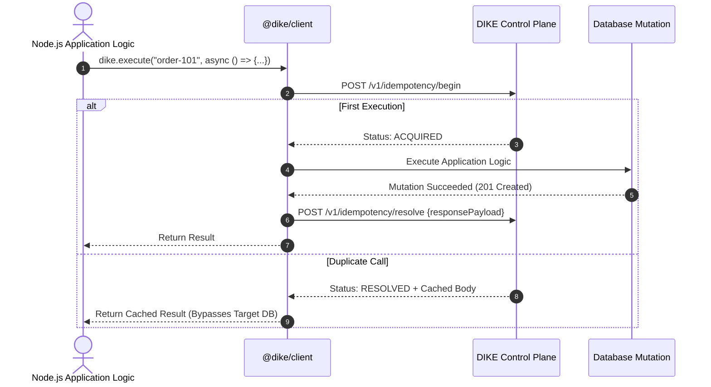
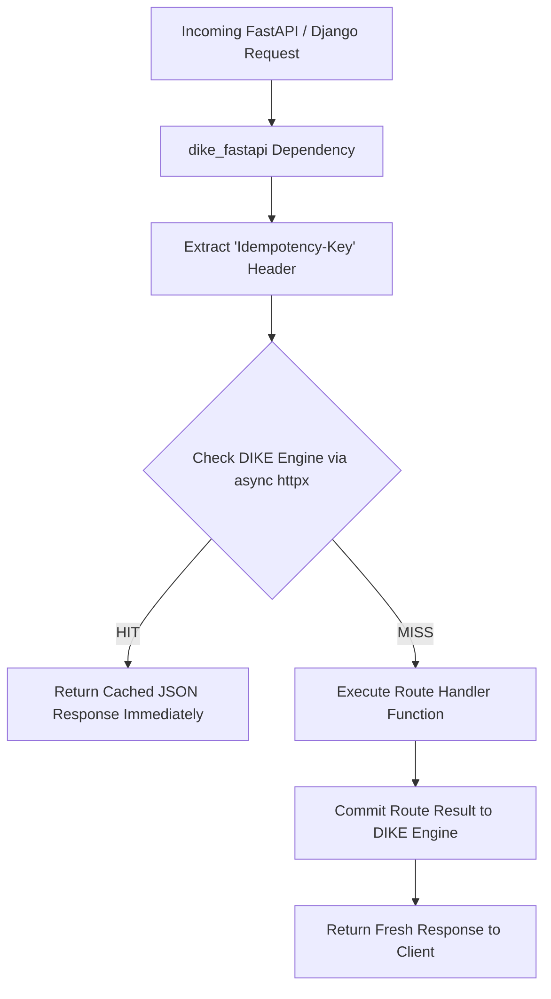
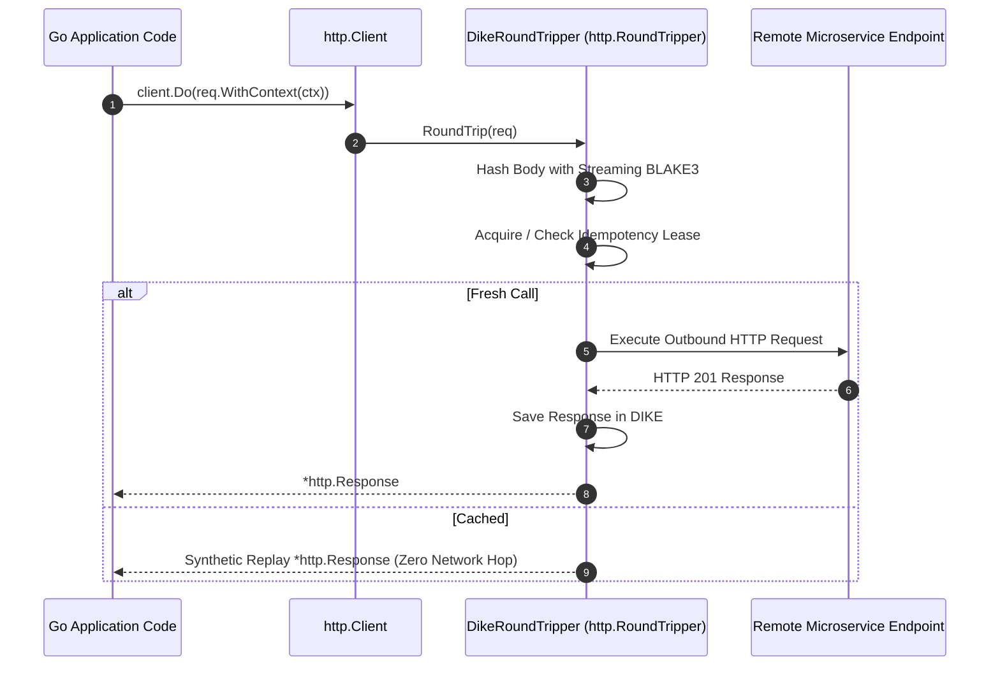
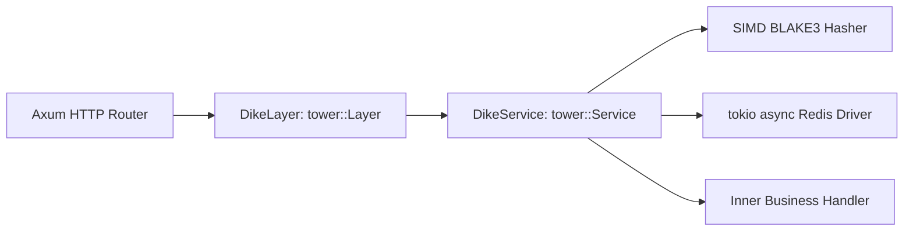
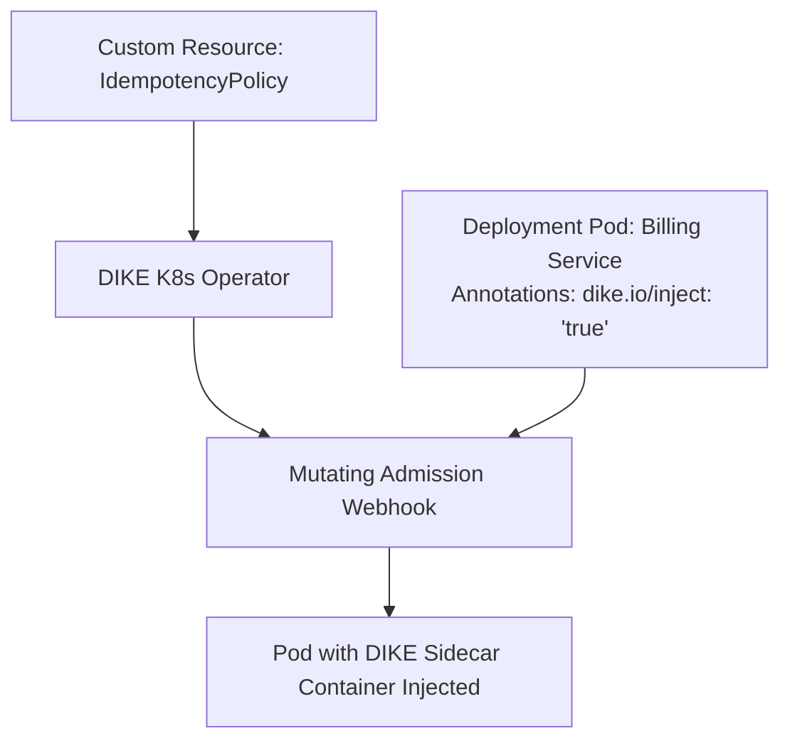
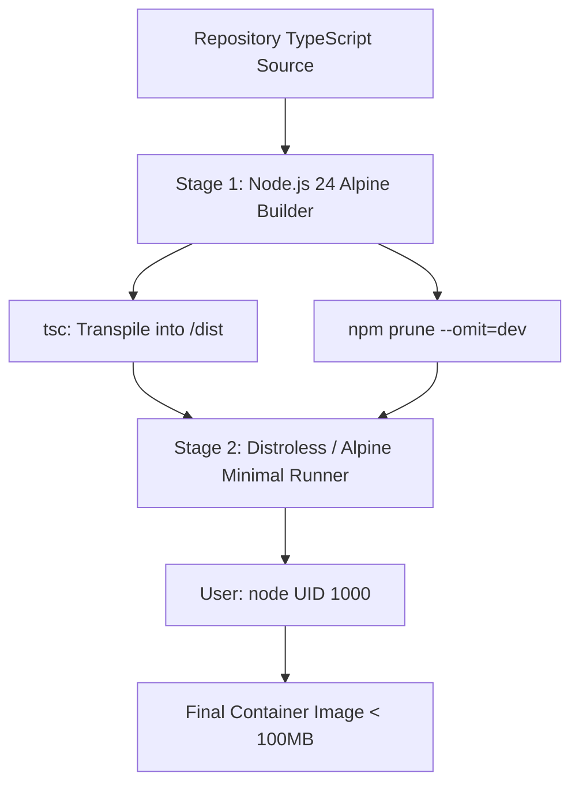
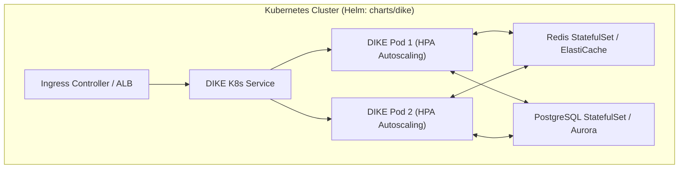
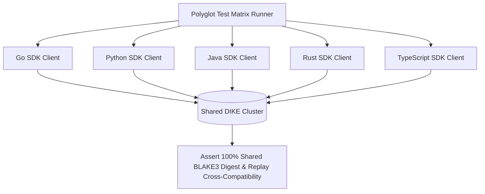

# Phase 7: Polyglot SDKs & Kubernetes Operator

This document details all Phase 7 implementation issues for the Distributed Idempotency Key Engine (DIKE), completing the 74-issue platform trajectory. It covers official polyglot SDKs (TypeScript, Python, Go, Java/Spring, Rust), the Kubernetes Operator with automated sidecar injection, and the V1.0 GA production release convergence.

---
title: "Official TypeScript / Node.js Client SDK (`@dike/client`)"
labels: ["phase:phase-7", "type:feature", "priority:P0-critical", "component:sdk/typescript"]
milestone: "M7: Polyglot SDKs & K8s Operator"
---

## Official TypeScript / Node.js Client SDK (`@dike/client`)

### Target Files
- [`packages/dike-client/`](file:///c:/Users/USER/Desktop/Extras/pending-projects/DIKE/packages/dike-client/)

### 1. Problem Statement
Applications wishing to invoke DIKE programmatically (rather than routing traffic through the reverse proxy) require a clean, typed SDK that wraps arbitrary async mutations.

### 2. Client SDK Interaction Flow


### 3. Technical Specification
- Publish lightweight SDK:
  ```typescript
  import { DikeClient } from '@dike/client';
  
  const dike = new DikeClient({ baseUrl: 'http://localhost:3000', apiKey: 'sec_...' });
  
  const result = await dike.execute({
    key: 'order-12345',
    action: async () => await processCreditCardCharge(order)
  });
  ```
- Includes automated retry backoff, streaming hash calculation, and receipt validation.

### 4. Acceptance Criteria
- [ ] Wraps arbitrary async functions with automatic idempotency protection.
- [ ] Zero runtime external dependencies other than standard fetch.

---
title: "Official Python Client SDK (`dike-py`) with FastAPI & Django Middleware"
labels: ["phase:phase-7", "type:feature", "priority:P0-critical", "component:sdk/python"]
milestone: "M7: Polyglot SDKs & K8s Operator"
---

## Official Python Client SDK (`dike-py`) with FastAPI & Django Middleware

### Target Files
- [`packages/dike-py/`](file:///c:/Users/USER/Desktop/Extras/pending-projects/DIKE/packages/dike-py/)

### 1. Problem Statement
Python is the dominant backend language for AI services, fintech startups, and data APIs. Developers need idiomatic middleware for FastAPI, Django, and Flask.

### 2. Python Middleware Pipeline Flowchart


### 3. Technical Specification
- Implement async Python client using `httpx`.
- Provide FastAPI dependency:
  ```python
  @app.post("/v1/charge")
  async def charge(
      order: OrderPayload, 
      idempotent: Idempotent = Depends(dike_fastapi(ttl=86400))
  ):
      return await process_payment(order)
  ```
- Django middleware inspecting `request.META["HTTP_IDEMPOTENCY_KEY"]`.

### 4. Acceptance Criteria
- [ ] Published to PyPI as `dike-py`.
- [ ] 100% test pass across Python 3.10, 3.11, and 3.12.

---
title: "Official Go Client SDK (`dike-go`) with Native `http.RoundTripper`"
labels: ["phase:phase-7", "type:feature", "priority:P0-critical", "component:sdk/go"]
milestone: "M7: Polyglot SDKs & K8s Operator"
---

## Official Go Client SDK (`dike-go`) with Native `http.RoundTripper`

### Target Files
- [`packages/dike-go/`](file:///c:/Users/USER/Desktop/Extras/pending-projects/DIKE/packages/dike-go/)

### 1. Problem Statement
High-throughput Go microservices need a zero-allocation client supporting context cancellation and standard library HTTP transports.

### 2. Go Transport Interceptor Diagram


### 3. Technical Specification
- Implement `dike-go` module:
  ```go
  client := dike.NewClient(dike.Config{BaseURL: "http://dike:3000"})
  transport := dike.NewRoundTripper(client, http.DefaultTransport)
  httpClient := &http.Client{Transport: transport}
  ```
- Automatic BLAKE3 hashing over `http.Request.Body`.

### 4. Acceptance Criteria
- [ ] Passes `golangci-lint` with zero warnings.
- [ ] Benchmarks demonstrate $< 50$ bytes memory allocation per request on hot path.

---
title: "Official Java / Kotlin SDK with Spring Boot Starter (`dike-spring-boot-starter`)"
labels: ["phase:phase-7", "type:feature", "priority:P0-critical", "component:sdk/java"]
milestone: "M7: Polyglot SDKs & K8s Operator"
---

## Official Java / Kotlin SDK with Spring Boot Starter (`dike-spring-boot-starter`)

### Target Files
- [`packages/dike-spring-boot-starter/`](file:///c:/Users/USER/Desktop/Extras/pending-projects/DIKE/packages/dike-spring-boot-starter/)

### 1. Problem Statement
Enterprise banking systems rely heavily on the Spring ecosystem. Developers require annotation-driven idempotency that integrates seamlessly with Spring Data and Spring Web.

### 2. AspectJ Interception Flow
```mermaid
flowchart TD
    Inbound[Controller Call: executeTransfer()] --> Aspect[AspectJ Interceptor: @Idempotent]
    Aspect --> KeyEval[SpEL Expression Evaluator: #request.transactionId]
    KeyEval --> DikeCheck{Query DIKE Storage Engine}
    DikeCheck -->|Cached| ReturnStored[Return Stored ResponseEntity Immediately]
    DikeCheck -->|Acquired| ProceedMethod[proceed(): Execute Database Service Method]
    ProceedMethod --> CommitState[Save Method Return Value in DIKE]
    CommitState --> Outbound[Return ResponseEntity]
```

### 3. Technical Specification
- Implement `@Idempotent` aspect using AspectJ:
  ```java
  @PostMapping("/v1/transfer")
  @Idempotent(key = "#request.transactionId", ttl = "48h")
  public ResponseEntity<TransferResponse> executeTransfer(@RequestBody TransferRequest request) {
      return ResponseEntity.ok(transferService.process(request));
  }
  ```
- Auto-configure Redis or HTTP connection to DIKE control plane via `application.yml`.

### 4. Acceptance Criteria
- [ ] Published to Maven Central as `io.github.inkesk-dozing:dike-spring-boot-starter`.
- [ ] Works with Spring Boot 3.2+ and WebFlux.

---
title: "Official Rust Crate (`dike-rs`) with Axum & Tower Middleware"
labels: ["phase:phase-7", "type:feature", "priority:P1-high", "component:sdk/rust"]
milestone: "M7: Polyglot SDKs & K8s Operator"
---

## Official Rust Crate (`dike-rs`) with Axum & Tower Middleware

### Target Files
- [`packages/dike-rs/`](file:///c:/Users/USER/Desktop/Extras/pending-projects/DIKE/packages/dike-rs/)

### 1. Problem Statement
High-performance infrastructure built on Rust (e.g. trading engines, blockchain bridges) requires a native crate integrating with Tower and Axum.

### 2. Tower Layer Architecture Diagram


### 3. Technical Specification
- Implement `tower::Layer` and `tower::Service` for DIKE.
- Asynchronous tokio-based client connecting to Redis or DIKE gRPC plane.

### 4. Acceptance Criteria
- [ ] Published to crates.io as `dike-rs`.
- [ ] Compiles on stable Rust toolchain without `unsafe` blocks.

---
title: "Kubernetes Custom Resource Definition (CRD) Operator & Mutating Webhook"
labels: ["phase:phase-7", "type:feature", "priority:P0-critical", "component:k8s/operator"]
milestone: "M7: Polyglot SDKs & K8s Operator"
---

## Kubernetes Custom Resource Definition (CRD) Operator & Mutating Webhook

### Target Files
- [`deploy/operator/`](file:///c:/Users/USER/Desktop/Extras/pending-projects/DIKE/deploy/operator/)

### 1. Problem Statement
Kubernetes platform teams need declarative GitOps management of idempotency policies across hundreds of microservices with automated sidecar proxy injection.

### 2. Kubernetes Operator Architecture Diagram


### 3. Technical Specification
- Define CRD `idempotency.dike.io/v1alpha1`.
- Implement Go operator using `controller-runtime` and `kubebuilder`.
- Mutating admission webhook intercepts pods with annotation `dike.io/inject: "true"` and automatically injects DIKE sidecar proxy container.

### 4. Acceptance Criteria
- [ ] CRD reconciles cleanly inside Kubernetes 1.28+.
- [ ] Automatically injects sidecar container when pod is scheduled.

---
title: "Hardened Multi-Stage Container Dockerfile (< 100MB Distroless Image)"
labels: ["phase:phase-7", "type:devops", "priority:P1-high", "component:deployment/docker"]
milestone: "M7: Polyglot SDKs & K8s Operator"
---

## Hardened Multi-Stage Container Dockerfile (< 100MB Distroless Image)

### Target Files
- [`Dockerfile`](file:///c:/Users/USER/Desktop/Extras/pending-projects/DIKE/Dockerfile)

### 1. Problem Statement
Production container images must be minimal, hardened, and free of development dependencies or build tools.

### 2. Multi-Stage Build Layers Architecture


### 3. Technical Specification
- Write multi-stage Dockerfile:
  - Stage 1 (`builder`): Compiles TypeScript into `/dist`.
  - Stage 2 (`runner`): Node.js 24 Distroless/Alpine image running as unprivileged `node` user (UID 1000).

### 4. Acceptance Criteria
- [ ] Final production image size $< 100$MB.
- [ ] Zero root processes running inside container.

---
title: "Production Docker Compose Clustered Stack & Helm Charts"
labels: ["phase:phase-7", "type:devops", "priority:P0-critical", "component:deployment"]
milestone: "M7: Polyglot SDKs & K8s Operator"
---

## Production Docker Compose Clustered Stack & Helm Charts

### Target Files
- [`docker-compose.yml`](file:///c:/Users/USER/Desktop/Extras/pending-projects/DIKE/docker-compose.yml)
- [`charts/dike/`](file:///c:/Users/USER/Desktop/Extras/pending-projects/DIKE/charts/dike/)

### 1. Problem Statement
Teams must be able to spin up a fully functioning, clustered DIKE environment (DIKE, PostgreSQL, Redis, Prometheus, Mock Backend) with a single command or deploy via Helm.

### 2. Kubernetes Cluster Helm Deployment Topology


### 3. Technical Specification
- Configure production-grade `docker-compose.yml` with health check dependencies.
- Package production Helm chart with configurable replica count and autoscaling (HPA).

### 4. Acceptance Criteria
- [ ] `docker compose up -d` boots entire cluster into healthy state within 10 seconds.
- [ ] `helm install dike ./charts/dike` deploys cleanly to Kubernetes.

---
title: "Cross-Language Polyglot Interoperability Verification Suite & V1.0 GA Release"
labels: ["phase:phase-7", "type:test", "priority:P0-critical", "component:release"]
milestone: "M7: Polyglot SDKs & K8s Operator"
---

## Cross-Language Polyglot Interoperability Verification Suite & V1.0 GA Release

### Target Files
- [`tests/polyglot_matrix.sh`](file:///c:/Users/USER/Desktop/Extras/pending-projects/DIKE/tests/polyglot_matrix.sh)
- [`CHANGELOG.md`](file:///c:/Users/USER/Desktop/Extras/pending-projects/DIKE/CHANGELOG.md)

### 1. Problem Statement
Final graduation of DIKE into production V1.0 GA release with 74 completed and verified issues.

### 2. Polyglot Test Matrix Architecture


### 3. Technical Specification
- Automated test script spawning 5 test clients in different languages (TypeScript, Python, Go, Java, Rust) targeting a shared DIKE cluster.
- Validate that a key initiated by Go is correctly recognized and replayed by Python or Java.
- Tag official release `v1.0.0`.

### 4. Acceptance Criteria
- [ ] 100% interoperability verified across all 5 programming language SDKs.
- [ ] All 74 roadmap issues marked complete and tested.
- [ ] Signed Git release tag `v1.0.0` published.
