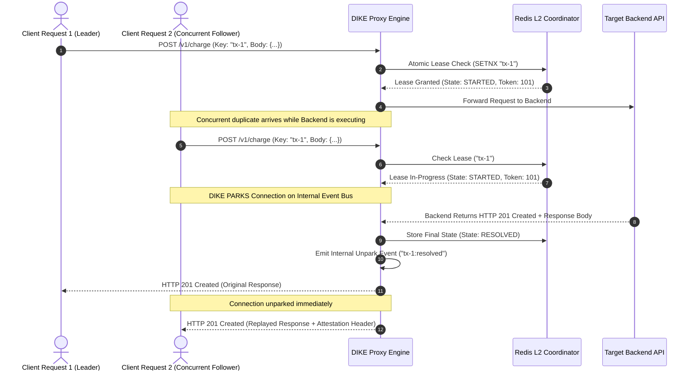

# DIKE Enterprise Architectural Specification & Design Rationale

## 1. Executive Summary & Product Vision

In distributed enterprise topologies, mutation endpoints (e.g. `POST /v1/payments`, `POST /v1/orders`, `POST /v1/ledger`) are fundamentally vulnerable to network-induced state corruption. When an ephemeral network disconnect, timeout, or mobile connection reset occurs, client libraries retry automatically.

Without strict, verified idempotency, retries produce **double-spend mutations, duplicate ledger writes, and uncoordinated state corruption**.

**DIKE (Distributed Idempotency Key Engine)** is an enterprise platform engineered to provide a mathematically rigorous, zero-compromise solution. It combines:
1. **A Three-Tier Storage Pipeline (L1 Memory $\to$ L2 Redis Lease $\to$ L3 PostgreSQL ACID Vault).**
2. **Asynchronous Connection Parking:** Eliminates `409 Conflict` thundering herds by holding concurrent duplicates on an async event bus and resolving them instantly when the leader completes.
3. **Streaming BLAKE3 Cryptographic Fingerprinting:** Ensures strict $O(1)$ constant memory overhead during payload verification.
4. **Cryptographic Attestation Receipts:** HMAC-SHA256 and Ed25519 signatures proving response provenance for financial audits.
5. **Gateway & Service Mesh Native Execution:** Envoy WASM filters and Kong plugins enabling zero-sidecar in-memory execution.
6. **Developer & Audit Web Console:** Live key inspector, real-time unparking telemetry, and visual payload diffs.
7. **Semantic Payload Hashing & PCI-DSS Masking:** Ignores dynamic nonces/timestamps and automatically redacts sensitive cardholder data.

---

## 2. Global Enterprise System Architecture

```mermaid
flowchart TD
    subgraph IngressClients["Ingress Traffic Tier"]
        C1["Client Application (Web / Mobile / Webhook)"]
        C2["Partner API Consumer"]
    end

    subgraph GatewayMesh["Ingress Gateway & Service Mesh Tier"]
        Envoy["Envoy Proxy (Rust WASM Filter)"]
        Kong["Kong API Gateway (Lua Plugin)"]
        Cloudflare["Cloudflare Edge Worker"]
        Sidecar["DIKE Standalone Proxy Container"]
    end

    subgraph DIKECore["DIKE Distributed Control Plane"]
        GW["Fastify API Gateway Listener"]
        SemanticHasher["Streaming BLAKE3 & Semantic JSON Diff Engine"]
        FSM["Deterministic Idempotency State Machine"]
        ParkingEngine["Async Connection Parking Bus (EventEmitter / PubSub)"]
        Attestation["Ed25519 / HMAC Attestation Signer"]
        KMS["HashiCorp Vault / AWS KMS Key Provider"]

        subgraph StorageHierarchy["Three-Tier Storage Hierarchy"]
            L1["L1: Lock-Free In-Memory Radix Ring Buffer (< 0.1 µs)"]
            L2["L2: Redis / Dragonfly Lease Coordinator (0.5 - 1.5 ms)"]
            L3["L3: PostgreSQL 16+ ACID Vault & Audit Log (2.0 - 5.0 ms)"]
        end
    end

    subgraph ManagementConsole["Developer & Operations Plane"]
        WebUI["DIKE Developer Web Console (React / Tailwind)"]
        Prom["Prometheus & OpenTelemetry Collector"]
    end

    subgraph UpstreamServices["Upstream Microservices Fleet"]
        CoreAPI["Target Core API (Billing, Orders, Banking)"]
        CoreDB[("Business Relational Database")]
    end

    C1 --> Envoy
    C1 --> Kong
    C2 --> Sidecar
    
    Envoy --> DIKECore
    Kong --> DIKECore
    Sidecar --> DIKECore

    GW --> SemanticHasher
    SemanticHasher --> FSM

    FSM <--> L1
    FSM <--> L2
    FSM <--> L3

    FSM -->|State: STARTED (First In-Flight Request)| CoreAPI
    FSM -->|State: IN_PROGRESS (Concurrent Duplicate)| ParkingEngine
    FSM -->|State: RESOLVED (Idempotent Cache Hit)| Attestation

    CoreAPI --> CoreDB
    CoreAPI -->|HTTP 200/201 Original Response| FSM

    FSM -->|Persist Result| L3
    FSM -->|Hot Cache Update| L1
    FSM -->|Broadcast Unpark Event| ParkingEngine

    ParkingEngine -->|Unpark & Instant Replay| Envoy
    ParkingEngine -->|Unpark & Instant Replay| Sidecar
    Attestation <--> KMS

    WebUI <-->|GraphQL / REST Admin API| DIKECore
    DIKECore --> Prom
```

---

## 3. Subsystem Breakdown & Architectural Rationale

### 3.1 Streaming BLAKE3 & Semantic JSON Hasher
- **Why BLAKE3:** Standard MD5 is cryptographically broken; SHA-256 buffers consume excessive CPU on large bodies. BLAKE3 is tree-hashable, SIMD-accelerated (over 1 GB/s throughput), and immune to length-extension attacks.
- **Semantic Field Masking:** Financial requests often include nonces, client timestamps, or request IDs (e.g. `{"amount": 100, "clientTimestamp": 1798366530}`). Standard bitwise hashing generates false-positive `422 Mismatch` errors. DIKE parses the stream into a canonical JSON AST, strips configured ignore paths (`ignoreFields: ["clientTimestamp", "meta.nonce"]`), and hashes the normalized canonical projection.
- **PCI-DSS Compliance:** The hasher automatically masks Primary Account Numbers (PANs) adhering to Luhn algorithm detection before writing payloads to the L3 storage vault.

### 3.2 Asynchronous Connection Parking Engine
- **The Problem:** When 100 concurrent requests arrive with the same `Idempotency-Key` (e.g. during mobile retries or webhook bursts), traditional gateways return `409 Conflict`. Clients immediately retry in a tight loop, causing CPU churn and database connection pool saturation.
- **The Solution:** DIKE parks secondary connections on an async event listener (`ConnectionParkingLot`). When the primary execution finishes upstream, DIKE broadcasts the response payload across the local event bus and Redis Pub/Sub. All 99 waiting sockets resolve in $< 200\mu s$ without issuing additional requests to the upstream backend.



### 3.3 Three-Tier Storage Hierarchy
1. **L1 Process Memory Ring Buffer:** Sub-microsecond LRU Radix Map. Absorbs rapid-fire retry bursts ($< 60s$) directly inside the proxy process without network I/O.
2. **L2 Distributed Redis Coordinator:** Manages cluster-wide leader election, monotonic fencing tokens, and lease heartbeats. Guarantees that crashed workers do not cause deadlocks.
3. **L3 PostgreSQL ACID Vault:** Persists completed response payloads, audit trails, and multi-tenant credentials. Guarantees that idempotency records survive complete cluster reboots.

### 3.4 Cryptographic Attestation Receipts & Hardware Security Modules (HSM)
Every replayed response emitted by DIKE includes a cryptographically verifiable header:
```http
Idempotency-Status: HIT
Idempotency-Replayed-At: 2026-10-27T10:15:30.124Z
X-DIKE-Attestation: v1;sig=9f83acb...;ts=1798366530;kid=vault-key-2026
```
- Signing keys are dynamically sourced from **HashiCorp Vault Transit Engine** or **AWS KMS**.
- Downstream payment reconcilers verify that the response body returned to the customer is identical byte-for-byte to the original transaction output.

### 3.5 Envoy WASM Filter & Service Mesh Ecosystem
For high-performance zero-sidecar deployments, DIKE provides an **Envoy WebAssembly Filter written in Rust**:
- Intercepts requests directly within the Envoy worker thread before request routing.
- Communicates with DIKE L2 Redis via asynchronous Envoy Redis filters.
- Eliminates the additional network hop of an external sidecar proxy.

---

## 4. Technology Stack Decision Matrix

| Layer | Selected Standard | Evaluated Alternatives | Technical Decision Rationale |
| :--- | :--- | :--- | :--- |
| **Control Plane Runtime** | **Node.js 24 LTS & TypeScript 5** | Go, Rust, Java | Exceptional event-loop I/O multiplexing for async connection parking; type-safe schema compilation via TypeBox. |
| **HTTP Server Engine** | **Fastify v5** | Express, NestJS, Gin | Fastest Node.js HTTP framework; native support for raw stream piping; sub-millisecond route resolution. |
| **Mesh / Edge Filter** | **Rust (WebAssembly / proxy-wasm)** | C++, Lua | Memory-safe, zero-cost abstractions, compiles directly into Envoy WASM bytecode and Cloudflare Workers. |
| **Distributed Broker (L2)**| **Redis 7+ / Dragonfly** | etcd, Consul | Atomic Lua scripting for CAS check-and-set, integrated Pub/Sub for unparking, automatic TTL expiration. |
| **Durability Vault (L3)** | **PostgreSQL 16+** | MongoDB, DynamoDB | True ACID isolation, row-level locks (`SELECT ... FOR UPDATE`), native `jsonb` support, zero cloud vendor lock-in. |
| **Hashing Engine** | **BLAKE3 / Streaming SHA-256** | MD5, CRC32, Murmur3 | Cryptographically secure, SIMD-accelerated throughput exceeding 1 GB/s, immune to collision attacks. |
| **Developer Console UI** | **React 19 + Tailwind CSS + Vite** | Next.js, Vue, Svelte | Responsive Single Page Application (SPA) easily bundleable as a static asset inside the DIKE Go/Node binary. |
| **Testing & Benchmarks** | **Vitest + k6 + Toxiproxy** | Jest, Artillery, JMeter | Vitest enables deterministic concurrent race-condition simulation; k6 scripts simulate 1,000+ simultaneous connections with identical keys; Toxiproxy validates network partition recovery. |
