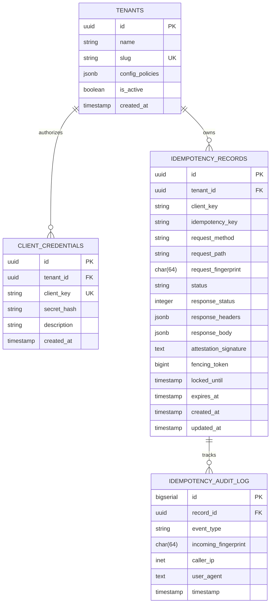
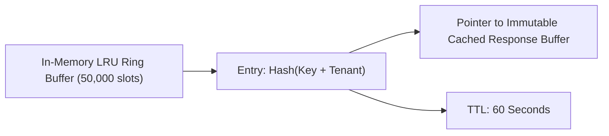

# DIKE Domain Data Model & Persistence Specification

## 1. Relational Entity-Relationship Model (PostgreSQL L3)

The persistent storage tier is designed for strict ACID durability, crash recovery, and multi-tenant isolation. It stores completed execution records, audited request fingerprints, and original response payloads.



---

## 2. PostgreSQL DDL Specification

```sql
-- Enums
CREATE TYPE idempotency_lifecycle_status AS ENUM (
    'STARTED',
    'RESOLVED',
    'FAILED'
);

-- Tenants Table
CREATE TABLE tenants (
    id UUID PRIMARY KEY DEFAULT gen_random_uuid(),
    name VARCHAR(255) NOT NULL,
    slug VARCHAR(64) NOT NULL UNIQUE,
    config_policies JSONB NOT NULL DEFAULT '{"defaultTtlSeconds": 86400, "maxPayloadBytes": 10485760}',
    is_active BOOLEAN NOT NULL DEFAULT TRUE,
    created_at TIMESTAMPTZ NOT NULL DEFAULT NOW()
);

-- Client API Credentials Table
CREATE TABLE client_credentials (
    id UUID PRIMARY KEY DEFAULT gen_random_uuid(),
    tenant_id UUID NOT NULL REFERENCES tenants(id) ON DELETE CASCADE,
    client_key VARCHAR(128) NOT NULL UNIQUE,
    secret_hash VARCHAR(255) NOT NULL,
    description TEXT,
    created_at TIMESTAMPTZ NOT NULL DEFAULT NOW()
);

-- Core Idempotency Records Table
CREATE TABLE idempotency_records (
    id UUID PRIMARY KEY DEFAULT gen_random_uuid(),
    tenant_id UUID NOT NULL REFERENCES tenants(id) ON DELETE CASCADE,
    client_key VARCHAR(128) NOT NULL,
    idempotency_key VARCHAR(255) NOT NULL,
    request_method VARCHAR(16) NOT NULL,
    request_path VARCHAR(2048) NOT NULL,
    request_fingerprint CHAR(64) NOT NULL, -- SHA-256 or BLAKE3 hex
    status idempotency_lifecycle_status NOT NULL DEFAULT 'STARTED',
    response_status INTEGER NULL,
    response_headers JSONB NULL,
    response_body JSONB NULL,
    attestation_signature TEXT NULL,
    fencing_token BIGINT NOT NULL DEFAULT 1,
    locked_until TIMESTAMPTZ NOT NULL,
    expires_at TIMESTAMPTZ NOT NULL,
    created_at TIMESTAMPTZ NOT NULL DEFAULT NOW(),
    updated_at TIMESTAMPTZ NOT NULL DEFAULT NOW(),
    CONSTRAINT uq_tenant_client_idempotency UNIQUE (tenant_id, client_key, idempotency_key)
);

-- Performance Indexes
CREATE INDEX idx_idempotency_expiry ON idempotency_records (expires_at);
CREATE INDEX idx_idempotency_lookup ON idempotency_records (tenant_id, client_key, idempotency_key);
CREATE INDEX idx_idempotency_fingerprint ON idempotency_records (request_fingerprint);

-- Audit Log Table
CREATE TABLE idempotency_audit_log (
    id BIGSERIAL PRIMARY KEY,
    record_id UUID NOT NULL REFERENCES idempotency_records(id) ON DELETE CASCADE,
    event_type VARCHAR(32) NOT NULL, -- 'FIRST_SEEN', 'CONCURRENT_WAIT', 'CACHE_HIT', 'MISMATCH_ABORT'
    incoming_fingerprint CHAR(64) NOT NULL,
    caller_ip INET NULL,
    user_agent TEXT NULL,
    timestamp TIMESTAMPTZ NOT NULL DEFAULT NOW()
);

CREATE INDEX idx_audit_record_id ON idempotency_audit_log (record_id);
```

---

## 3. Redis L2 Coordination Schema & Data Structures

Redis acts as the distributed coordination plane for multi-instance deployments:

```
┌────────────────────────────────────────────────────────────────────────┐
│                        REDIS KEY SPACE & TYPES                         │
├────────────────────────────────┬────────┬──────────────────────────────┤
│ Key Format                     │ Type   │ Purpose                      │
├────────────────────────────────┼────────┼──────────────────────────────┤
│ dike:lease:{tenant}:{key}      │ Hash   │ Active execution lock & FSM  │
│ dike:resolved:{tenant}:{key}   │ String │ Hot cache of finalized state │
│ dike:fence:counter             │ String │ Global 64-bit fencing token  │
│ dike:events:{tenant}:{key}     │ Pub/Sub│ Unparking channel for leader │
└────────────────────────────────┴────────┴──────────────────────────────┘
```

### Redis Lease Hash Fields (`dike:lease:{tenant}:{key}`)
- `token`: Monotonically increasing 64-bit integer fencing token.
- `fingerprint`: 64-character BLAKE3/SHA-256 hash string.
- `owner`: Hostname/PID of the worker holding the lease.
- `status`: `'STARTED'`.
- `created_at`: Unix timestamp in milliseconds.

### Atomic Lease Acquisition (Lua Script)
```lua
-- KEYS[1] = dike:lease:{tenant}:{key}
-- KEYS[2] = dike:resolved:{tenant}:{key}
-- ARGV[1] = incoming_fingerprint
-- ARGV[2] = lease_duration_ms
-- ARGV[3] = worker_id
-- ARGV[4] = current_time_ms

-- Check if already resolved in hot cache
local resolved = redis.call('GET', KEYS[2])
if resolved then
    return {'RESOLVED', resolved}
end

-- Check if active lease exists
local lease = redis.call('HMGET', KEYS[1], 'fingerprint', 'owner', 'token')
if lease[1] then
    -- Verify fingerprint matches
    if lease[1] ~= ARGV[1] then
        return {'MISMATCH', lease[1]}
    else
        return {'IN_PROGRESS', lease[2], lease[3]}
    end
end

-- Acquire new lease
redis.call('HSET', KEYS[1], 
    'fingerprint', ARGV[1],
    'owner', ARGV[3],
    'token', redis.call('INCR', 'dike:fence:counter'),
    'created_at', ARGV[4]
)
redis.call('PEXPIRE', KEYS[1], ARGV[2])
return {'ACQUIRED', redis.call('HGET', KEYS[1], 'token')}
```

---

## 4. In-Memory L1 Buffer Layout (Process Space)

To achieve sub-microsecond throughput for high-frequency retries, DIKE maintains a process-local lock-free ring buffer:



- **Data Structure:** High-performance radix trie / map keyed by `xxHash64(tenant_id + client_key + idempotency_key)`.
- **Memory Footprint:** Fixed upper bound (configurable, default: 128MB).
- **Eviction:** Strict LRU eviction coupled with an ephemeral 60-second sliding expiration.
- **Thread Safety:** Implemented with Node.js `SharedArrayBuffer` / worker threads or Go lock-free atomic pointers.

---

## 5. Retention & Compaction Strategy

1. **PostgreSQL Partitioning by Month:**
   For high-volume deployments exceeding 10M records/month, `idempotency_records` is partitioned by `created_at` using PostgreSQL range partitioning:
   ```sql
   CREATE TABLE idempotency_records_partitioned (
       LIKE idempotency_records INCLUDING ALL
   ) PARTITION BY RANGE (created_at);
   ```
2. **Automated Ephemeral Expiry Sweep:**
   A lightweight background worker executes a continuous batch deletion:
   ```sql
   DELETE FROM idempotency_records 
   WHERE id IN (
       SELECT id FROM idempotency_records 
       WHERE expires_at < NOW() 
       LIMIT 5000
   );
   ```
3. **Redis Native Eviction:**
   All Redis keys have strict `PEXPIRE` / `EXPIREAT` leases; memory reclamation is handled automatically by Redis `volatile-lru` eviction policy.
