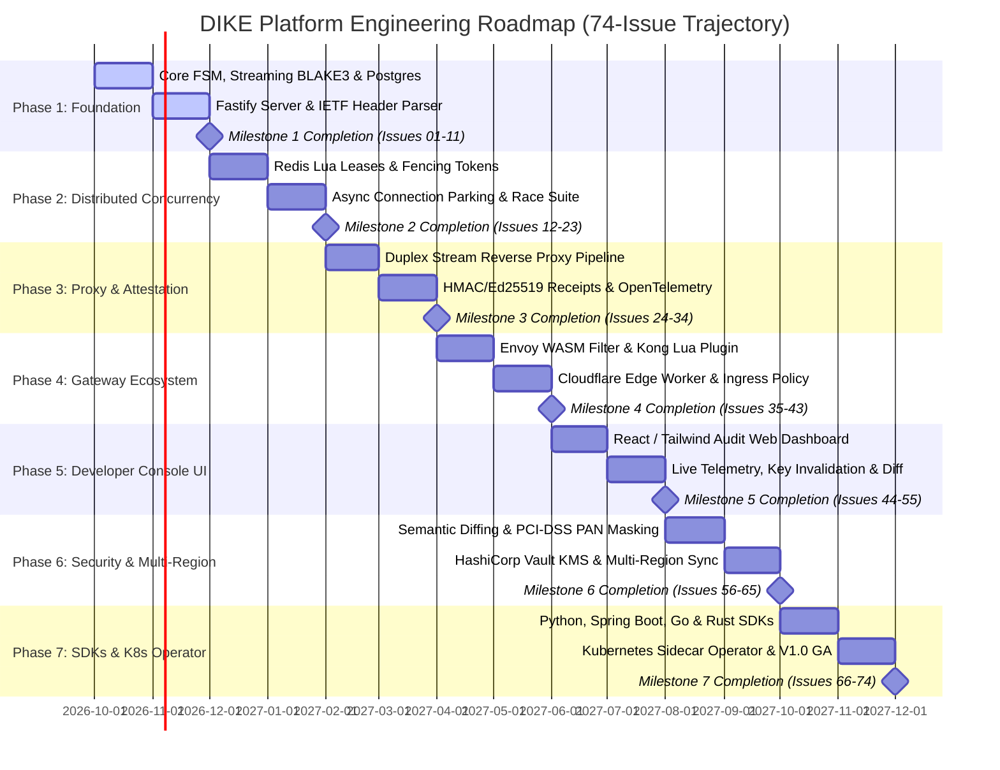
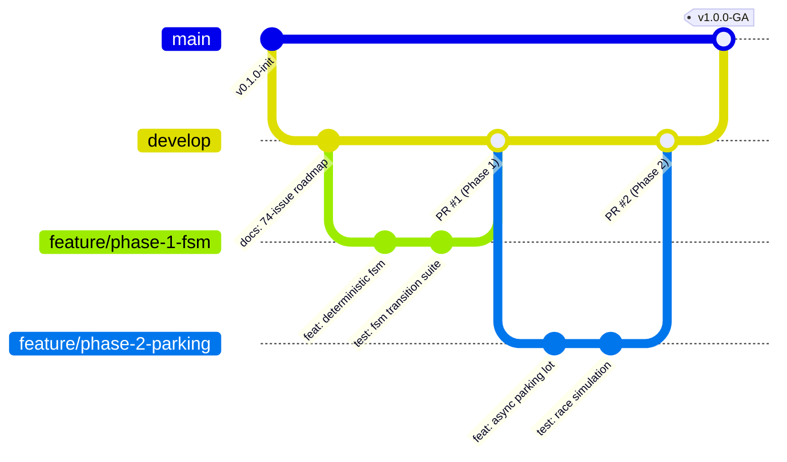

# DIKE Platform Engineering Roadmap (74-Issue Trajectory)

## 1. Overview & Evolutionary Phased Architecture

The platform engineering roadmap for DIKE spans **74 systematically planned, non-redundant issues** across seven evolutionary phases. Every issue corresponds to an atomic Pull Request addressing a concrete distributed systems challenge, transitioning DIKE from a core state machine into an enterprise-grade platform.

---

## 2. Release Milestones & Phase Breakdown

| Phase | Milestone Title | Issue Range | Issue Count | Focus & Deliverables |
| :--- | :--- | :--- | :--- | :--- |
| **Phase 1** | **Foundation & Core Engine** | `#01` to `#11` | 11 Issues | Scaffolding, FSM transitions, streaming BLAKE3 hasher, PostgreSQL ACID schema, Fastify server, IETF headers, log redaction. |
| **Phase 2** | **Distributed Concurrency & Parking** | `#12` to `#23` | 12 Issues | Redis Sentinel/Cluster pool, Lua atomic lease, fencing tokens, async connection parking, Pub/Sub unparking, race-condition harness. |
| **Phase 3** | **Transparent Proxy & Attestation** | `#24` to `#34` | 11 Issues | Reverse proxy pipeline, duplex stream tee, HMAC/Ed25519 receipts, RFC 7230 header filter, OpenTelemetry, S3 blob storage. |
| **Phase 4** | **Gateway Ecosystem & Plugins** | `#35` to `#43` | 9 Issues | Envoy WASM filter (Rust), Kong plugin (Lua), Cloudflare Worker, route matching, fail-open/closed policies, OCI containers. |
| **Phase 5** | **Developer Console & Audit UI** | `#44` to `#55` | 12 Issues | React 19 + Tailwind dashboard, live key inspector, visual payload diffing, real-time unparking speedometer, RBAC/SSO, audit ledger. |
| **Phase 6** | **Advanced Security & Multi-Region** | `#56` to `#65` | 10 Issues | Semantic JSON ignore paths, PCI-DSS PAN masking, HashiCorp Vault / KMS signers, active-active multi-region replication, SOC2 export. |
| **Phase 7** | **Polyglot SDKs & K8s Operator** | `#66` to `#74` | 9 Issues | Python, Spring Boot, Go, Rust SDKs, Kubernetes mutating webhook operator, Docker Compose cluster, Helm chart, V1.0 GA release. |
| **TOTAL** | **Full Production Lifecycle** | `#01` to `#74` | **74 Issues** | **Complete enterprise-grade idempotency ecosystem.** |

---

## 3. Git Branching Strategy & Quality Gates

DIKE enforces Trunk-Based Gitflow with mandatory linear history and squash merges. Direct commits to `main` are strictly blocked.

### Pull Request Acceptance Standards
1. **Zero-Linter Warnings:** ESLint and TypeScript strict mode must pass with zero warnings.
2. **Deterministic Concurrency Tests:** Every PR touching concurrency must pass the Vitest race-condition suite with randomized thread delays.
3. **Documentation Sync:** Architecture or schema changes must update `docs/ARCHITECTURE.md` or `docs/DATA_MODEL.md` in the same PR.
4. **Performance Gate:** Core engine operations must benchmark under 2ms p99 latency before merge approval.
