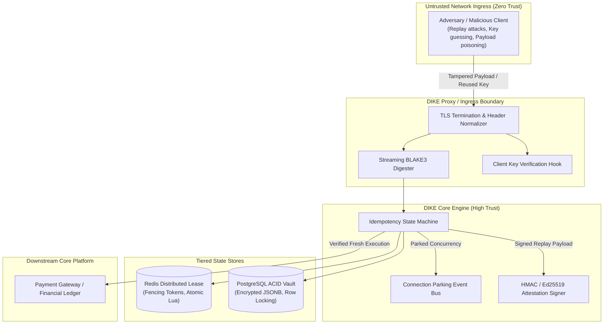
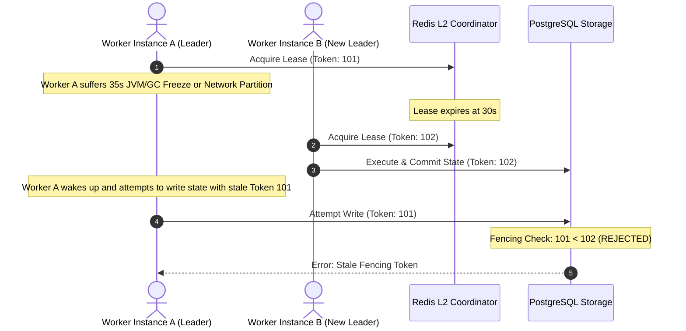

# DIKE Threat Model (STRIDE) & Security Posture

**Document Control**

| Field | Value |
| :--- | :--- |
| **Status** | Baseline Engineering Standard |
| **Milestone** | Phase 1 Foundation |
| **Classification** | High Security Sensitive |
| **Scope** | Distributed Idempotency Key Engine & Reverse Proxy |

---

## 1. Executive Security Summary

Idempotency engines govern financial and operational consistency across enterprise services. Compromising DIKE allows adversaries to force **double-credit issuance, replay fraudulent transactions, bypass payment verification, or cause denial-of-service across critical APIs**.

This document models trust boundaries, analyzes threat scenarios using the **STRIDE** methodology (Spoofing, Tampering, Repudiation, Information Disclosure, Denial of Service, Elevation of Privilege), and mandates technical controls.



---

## 2. Trust Boundaries & Security Zones

1. **Boundary A (Client $\to$ DIKE):** Completely untrusted. Incoming HTTP headers, bodies, and network metadata may be forged, malformed, or hostile.
2. **Boundary B (DIKE $\to$ Redis/PostgreSQL):** Internal trusted network (VPC / container network). Requires mutual TLS (mTLS) or private subnet isolation with least-privilege credentials.
3. **Boundary C (DIKE $\to$ Upstream Backend):** High trust. DIKE acts as the authoritative gatekeeper for upstream mutation endpoints.

---

## 3. STRIDE Threat Analysis Matrix

| Threat Category | Specific Threat Vector | Architectural Impact | Mitigation Strategy |
| :--- | :--- | :--- | :--- |
| **Spoofing** | Adversary reuses another customer's `Idempotency-Key` | Cross-tenant data leakage or hijacking another client's mutation | **Tenant Scoping:** All keys are strictly scoped by `(tenant_id, client_key, idempotency_key)`. Keys cannot cross tenant boundaries. |
| **Tampering** | Reusing a key with a modified request body (e.g. changing amount from \$10 to \$10,000) | State corruption or financial fraud | **Streaming Cryptographic Fingerprinting:** BLAKE3/SHA-256 hash comparison. Mismatched payloads trigger an immediate `422 Unprocessable Entity` before backend processing. |
| **Repudiation** | Client claims a replayed response was a newly initiated charge | Audit disputes and compliance failure | **Attestation Receipts:** DIKE issues an HMAC-SHA256 / Ed25519 signature over `(Key, Hash, Status, Timestamp)`. Cryptographic proof of replay. |
| **Information Disclosure** | Sensitive credit card numbers or credentials cached in response bodies | PCI-DSS / GDPR compliance breach | **Zero-Secret Logging & Field Redaction:** Logging framework redacts authorization headers and request bodies; PostgreSQL response storage supports column-level encryption (pgcrypto). |
| **Denial of Service** | Thundering-herd retry storms or multi-gigabyte payload memory exhaustion | Out-Of-Memory (OOM) crashes or thread pool starvation | **Streaming Hashing & Async Connection Parking:** Strict $O(1)$ memory consumption via stream piping; parking holds duplicates on async event bus without worker thread consumption. |
| **Elevation of Privilege** | Zombie worker wakes up after GC pause and overwrites finalized response | State corruption in storage tier | **Monotonically Increasing Fencing Tokens:** Every lock grant increments a 64-bit integer. Storage layers reject any write carrying a stale token. |

---

## 4. High-Impact Attack Scenarios & Mitigations

### 4.1 The Zombie Writer Problem (Split-Brain Mutation)



- **Mitigation:** PostgreSQL stored procedures and update queries enforce `WHERE fencing_token >= record.fencing_token`. Stale writes from delayed workers are rejected.

### 4.2 Payload Fingerprint Poisoning & Hash Collisions
- **Threat:** An attacker discovers or crafts a hash collision, allowing different request payloads to match an existing idempotency record.
- **Mitigation:** DIKE uses **BLAKE3** with 256-bit output or **SHA-256**. The birthday bound for a 256-bit cryptographic hash requires $> 2^{128}$ evaluations, rendering practical collision attacks impossible.
- **Verification Rule:** If `incoming_hash != stored_hash`, the engine immediately terminates with:
  ```json
  {
    "error": "IdempotencyKeyPayloadMismatch",
    "message": "The provided Idempotency-Key has already been used with a different request payload.",
    "statusCode": 422
  }
  ```

---

## 5. Security Checklist for Development Phases

- [ ] Strict Constant-Time comparison for all API key and HMAC verifications (`crypto.timingSafeEqual`).
- [ ] Enforce max payload size limits (e.g., 10MB default) at the proxy layer.
- [ ] Ensure non-idempotent HTTP methods (`GET`, `HEAD`, `OPTIONS`) bypass idempotency logic without state allocation.
- [ ] Implement rate-limiting on key allocation to prevent malicious resource exhaustion.
- [ ] Verify that all error responses omit internal stack traces and server environment variables.
